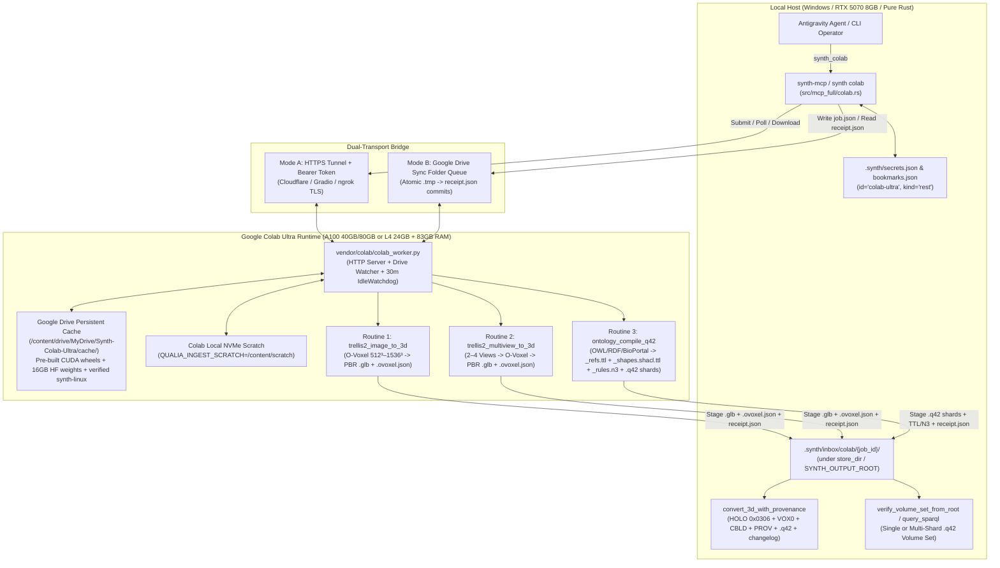

# Specification & Implementation Plan: `synth_colab` — Google Colab Ultra Heavy-Compute Burst Extension for Webizen AI Synth

**Copyright (c) 2026 Timothy Charles Holborn**  
**https://www.linkedin.com/in/ubiquitous/ | timothy.holborn@gmail.com**  
**License:** Attribution-NonCommercial-NoDerivatives 4.0 International (CC BY-NC-ND 4.0)  
**Target Repository:** `C:\github\synth` (Webizen AI Synth `0.0.41.14`)  
**Status:** Architecturally Reviewed & Finalized Work-Package Specification (v2)

---

## 1. Executive Summary & Architectural Motivation

Local development and operator machines (such as the current host with an **NVIDIA GeForce RTX 5070 Laptop GPU, 8,151 MiB VRAM**) run Webizen AI Synth's native 150-morphism Rust/WGSL/Etalon production pipeline instantaneously, but cannot locally host heavyweight 24 GB–80 GB VRAM or 60 GB+ System RAM batch jobs such as:
1. **`microsoft/TRELLIS.2-4B` (Image-to-3D O-Voxel & 4K PBR Generation):** Requires ~18 GB baseline VRAM just to load the 4B flow-matching transformer + DINOv3 conditioning backbone + segmentation model, peaking at 24 GB–36 GB VRAM for $1024^3$ and $1536^3$ sparse O-Voxel grids and 4K PBR texture baking.
2. **Massive Multi-Gigabyte Ontology Refactoring & `.q42` Volume Compilation (`ontology_compile_q42`):** Streaming, refactoring (purging `owl:Thing`/`owl:NamedIndividual`, generating `skos:Concept` linked references, SHACL shapes, and N3Logic rules), and sealing multi-hundred-MB or multi-GB OWL/RDF/BioPortal/GIS dumps on Google's gigabit backbone and 83 GB High-RAM instances.
3. **Volumetric O-Voxel $\rightarrow$ `.10d` v2 (`HOLO` `0x0306` + `VOX0` `SectionType::VoxelLattice = 22`) Field Extraction:** Extracting both a multi-segment `M64HoloRecord` cluster ($K \in [16, 256]$ segments, `max_raymarch_steps <= 32`) and a quantized `VOX0` sparse voxel DAG directly from `TRELLIS.2`'s internal O-Voxel field before triangle decimation so Synth's native `.10d` v2 compiler preserves volumetric field semantics instead of collapsing to a single-primitive bounding-box mesh fit.

With a **Google AI Ultra** account (providing priority **NVIDIA A100 40/80 GB VRAM**, **NVIDIA L4 24 GB VRAM**, ~83 GB High-RAM, 24-hour background execution, and Google Drive persistent storage), Synth treats Colab Ultra as an **on-demand remote heavy-compute burst worker** while keeping all canonical `.10d` v2 (`HOLO` `0x0306`), `.q42` (including multi-shard `Q42RolloverPublisher` volume sets), `.hmc`, `source-asset-licensing.n3`, and `.synth/changelog.json` sealing strictly inside Synth's native Rust authority.

---

## 2. Core Architectural Invariants & Reviewer Hardening Requirements

Every component of `synth_colab` strictly enforces the invariants in [`AGENTS.md`](../AGENTS.md) plus the findings from our Principal Systems & Graphics Architect Review:

1. **Zero Pollution of Native Rust / Etalon Binaries & `MAX_TOOLS` Budget Compliance:**
   - `synth` and `synth-mcp` remain 100% pure Rust (`ureq` + `serde_json` + `sha2` + `qualia-core-db`). No Python, PyTorch, or CUDA dependencies are linked into Synth.
   - `synth_colab` registers as a single unified MCP tool in `StandaloneSynthMcp::synth_tools()` (staying well within `comprehensive_protocol_limits().max_tools = 128`).
2. **Strict Input/Output Confinement (`SYNTH_INPUT_ROOT` vs. `SYNTH_OUTPUT_ROOT` / `bookmarks::store_dir()`):**
   - **`SYNTH_INPUT_ROOT` is strictly read-only:** Every local input file (`image_path`, `image_paths`, `source_path`, `evidence_q42`) MUST be validated through `mcp.input_root.resolve_path(path, max_bytes)` (32 MiB cap for images; 4 GiB streaming cap for local ontology dumps), enforcing parent-traversal (`..`) and symlink/reparse-point rejection.
   - **Staging Inbox Under `.synth/inbox/colab/{job_id}/`:** Remote job downloads and receipts are never written into `SYNTH_INPUT_ROOT`. They are staged under `bookmarks::store_dir()?.join("inbox").join("colab").join(&job_id)` (which resolves under `SYNTH_BOOKMARK_ROOT`, `project.root`, or `SYNTH_OUTPUT_ROOT/.synth/`) with strict single-segment path validation (`^[A-Za-z0-9._-]+$`, max 96 chars, no `..`, `/`, `\`, or `:`).
   - **Windows Google Drive (`DriveQ`) Reparse Point Separation:** Because Google Drive for Desktop (`G:\My Drive\...`) uses Windows Cloud Filter reparse points (`FILE_ATTRIBUTE_REPARSE_POINT`, `0x400`), `DriveQ` uses its own dedicated `DriveQueueRoot` validator (checking canonical prefix confinement, atomic `.tmp` $\rightarrow$ `receipt.json` ordering, filename sanitization, and byte budgets) rather than routing through `InputRoot`.
3. **Holographic 10D v2 Primacy (`HOLO` `0x0306` + `VOX0`) Over Triangle-Soup Drift:**
   - When `synth_colab` runs `trellis2_image_to_3d` or `trellis2_multiview_to_3d`, the Colab worker exports:
     1. The decimated/remeshed PBR `.glb` (`o_voxel.postprocess.to_glb`), and
     2. An **O-Voxel Volumetric Sidecar (`.ovoxel.json`)** containing:
        - Multi-segment `M64HoloRecord` cluster parameters ($K \in [16, 256]$ segments fitted from O-Voxel connected components/octants, each with `local_origin`, `scale_bounds`, 12 `sdf_harmonics`, `spectral_spd_base`, and `subsurface_roughness`, capped at `< 32` raymarch steps).
        - Quantized `VOX0` (`SectionType::VoxelLattice = 22`) sparse voxel octree/DAG summary (`VoxelSectionMiniHeader` + `Vox0DagNode` records).
   - Upon ingestion into Synth, `synth_colab` invokes the refactored, confined **`convert_3d_with_provenance(...)`** in `src/model_validation.rs`, which:
     - Validates `source-asset-licensing.n3` fail-closed.
     - Seals `{stem}-archetype.10d` (`HOLO` `0x0306` + `PROV` + `CBLD` `0x0305`), `instances/*.10d` (`AREF`/`IOVR`/`INST` Mode-B constituency), **and** writes the companion `{stem}-provenance.n3` / `{stem}-provenance.q42` + extracted texture dependencies to disk.
     - Injects the actual `SoftwareAgentRecord` (`microsoft/TRELLIS.2-4B`), `HarnessEnvironmentRecord` (Colab GPU name, VRAM, CUDA version), `RevisionEconomicsTelemetry` (wall-clock ms, peak VRAM/RAM, estimated energy joules), and `epistemic_horizon_q42_sha256` into `.synth/changelog.json`.
4. **Source-Asset Licensing High-Water Mark & Moral Rights Attribution (UDHR Art. 27 / ICESCR Art. 15):**
   - Never use `"sovereign"` or `"self-sovereign"` vocabulary. Use human-rights agreement terminology (**human rights**, **human dignity**, **human agency**, **natural person**, **moral and material interests of the author**, **Permissive Commons**).
   - Never place an AI model (`microsoft/TRELLIS.2-4B`) into `HumanActorRecord` (`AgentType::NaturalPerson`). The natural person steward/author remains in `HumanActorRecord`, while `microsoft/TRELLIS.2-4B` is recorded in `SoftwareAgentRecord` (`role: "conversion"`).
   - Enforce the **input reference image's license high-water mark**: require explicit `spdx_license` and `attribution_notice` for the input reference image when `auto_convert_10d = true` rather than silently stamping `CC-BY-NC-ND-4.0` onto unverified third-party images.
5. **Biosphere Evidence Gate (`synth_production_rules`) & Repository Org Split (`qualia-poiesis` vs. `intenteco`):**
   - For `trellis2_image_to_3d` and `trellis2_multiview_to_3d`, `synth_colab` calls `crate::operator::enforce_produce` (`action = "produce"`) **both at `submit` time** (before spending Colab Compute Units) **and at `ingest` time** (before running `convert_3d_with_provenance`). If `domain == "biosphere"` and `fiction != Some(true)`, an admitted evidence `.q42` (verified via `InputRoot`) must exist first.
   - For `ontology_compile_q42`, `synth_colab` evaluates rules with `action = "compile_q42"` (which is explicitly permitted without prior evidence because `.q42` compilation *is* the evidence path).
   - Supports target domain routing (`domain = "made_world"` $\rightarrow$ `C:\github\poiesis\<slug>` vs. `domain = "biosphere"` $\rightarrow$ `C:\github\eco-intent\<slug>`) and emits a companion `manifest.q42.yaml` stub mapping the 7-layer computational hierarchy (`L0`–`L6`, with `L6` = `L6QuantumPhysics`).
6. **Secret Redaction, Token-Stdin CLI & TLS Enforcement:**
   - `synth colab configure` stores public endpoint metadata in `.synth/bookmarks.json` under `id = "colab-ultra"`, `kind = "rest"` (upserted *before* calling `bookmarks::set_secret`), and stores the Bearer token in gitignored `.synth/secrets.json`.
   - CLI never suggests or requires `--token <SECRET>` in plain command-line arguments: it supports `SYNTH_COLAB_TOKEN` env var or `--token-stdin` so tokens never leak into shell history or OS process lists.
   - Remote HTTP transport strictly requires `https://` whenever a Bearer token is sent (permitting `http://` only for loopback `127.0.0.1` / `localhost` during local testing). Error messages strip URLs/headers so secrets are never echoed.

---

## 3. System Architecture & Dual-Transport Protocol



---

## 4. Supported Colab Routines (v1 Catalog)

### Routine 1: `trellis2_image_to_3d`
- **Purpose:** Convert a single reference image (photograph or Synth `radiance` concept render) under `SYNTH_INPUT_ROOT` into a textured PBR `.glb` + `.ovoxel.json` volumetric field package (`M64HoloRecord` multi-segment clusters + `VOX0` DAG nodes) using `microsoft/TRELLIS.2-4B`.
- **Parameters:**
  - `image_path`: Local path under `SYNTH_INPUT_ROOT` (PNG/JPEG/WebP, max 32 MiB).
  - `resolution`: `512` | `1024` | `1536` (default `1024`; `1536` targets A100 40GB+).
  - `seed`: Integer (default `42`).
  - `decimation_target`: Target triangle count (`4_000`..=`350_000`, default `120_000` so it stays well within Synth's `200k` vertex / `400k` triangle `production16` ring budget).
  - `texture_size`: `1024` | `2048` | `4096` (default `2048`).
  - `remesh`: Boolean (default `true`).
  - `export_ovoxel_summary`: Boolean (default `true`) — exports multi-segment `M64HoloRecord` cluster descriptors ($K \in [16, 256]$) and quantized `VOX0` octree nodes in `.ovoxel.json`.
  - `auto_convert_10d`: Boolean (default `true`) — invokes `convert_3d_with_provenance` upon ingestion to seal `{stem}-archetype.10d` (`HOLO` `0x0306` + `CBLD` + `PROV`), `instances/*.10d`, `{stem}-provenance.q42`, `manifest.q42.yaml` (`L0`–`L6`), `.synth/license-contract.json`, and `.synth/changelog.json`.

### Routine 2: `trellis2_multiview_to_3d`
- **Purpose:** Multi-image conditioned 3D generation using 2–4 reference views (such as `front-view-assumed.png`, `side-view-assumed.png`, `three-quarter-view-assumed.png`).
- **Parameters:**
  - `image_paths`: Array of 2..=4 local image paths under `SYNTH_INPUT_ROOT` (each $\le 32$ MiB).
  - Same `resolution`, `seed`, `decimation_target`, `texture_size`, `remesh`, `export_ovoxel_summary`, and `auto_convert_10d` options as Routine 1.

### Routine 3: `ontology_compile_q42`
- **Purpose:** Offload downloading, No-Commodification-of-Life OWL refactoring (`owl:Thing` purge $\rightarrow$ `skos:Concept` linked references + SHACL shapes + N3Logic rules), and `.q42` volume compilation of massive ontologies to Colab Ultra's 83 GB High-RAM instance using a SHA-256/Ed25519-verified Linux `x86_64` `synth` binary and local NVMe scratch (`QUALIA_INGEST_SCRATCH=/content/scratch`).
- **Parameters:**
  - `acronym` (BioPortal ontology acronym), `source_url` (remote RDF/OWL dump), or `source_path` (local file under `SYNTH_INPUT_ROOT`).
  - `download_format`: Optional `"rdf" | "owl" | "ttl" | "csv"`.
  - `context_iri`: Optional named graph IRI.
  - `refactor_owl`: Boolean (default `true` for OWL/BioPortal) — produces `_refs.ttl`, `_shapes.shacl.ttl`, and `_rules.n3` and compiles all three into the `.q42` volume.
  - `out_q42`: Target `.q42` filename (`^[A-Za-z0-9_-][A-Za-z0-9._-]*\.q42$`).
  - `segment_mib`: Optional multi-segment volume cap (supports `Q42RolloverPublisher` `{stem}-root.q42` + `{stem}-0000.q42` shard sets).
  - `ingest_to_graph`: Boolean (default `false`) — after verifying the downloaded `.q42` (or multi-shard volume set via `verify_volume_set_from_root`), optionally ingests it into the local Synth daemon graph.

---

## 5.Unified `ColabArg` Schema & Action Contract

```rust
#[derive(Debug, Clone, Deserialize, Default)]
#[serde(default, deny_unknown_fields)]
pub struct ColabArg {
    /// "status" | "configure" | "routines" | "submit" | "poll" | "ingest" | "list_jobs" | "cancel" | "export_notebook"
    pub action: Option<String>,
    /// Routine ID: "trellis2_image_to_3d" | "trellis2_multiview_to_3d" | "ontology_compile_q42"
    pub routine: Option<String>,
    /// Transport mode: "auto" | "http" | "drive_queue"
    pub transport: Option<String>,
    /// Remote Colab worker HTTPS base URL (stored in .synth/bookmarks.json id="colab-ultra")
    pub endpoint_url: Option<String>,
    /// Bearer API token (stored in gitignored .synth/secrets.json id="colab-ultra")
    pub api_token: Option<String>,
    /// Local Google Drive sync root directory (e.g. "G:\\My Drive\\Synth-Colab-Ultra")
    pub drive_queue_dir: Option<String>,
    /// Idle auto-disconnect timeout in minutes on Colab Ultra (default: 30)
    pub idle_timeout_minutes: Option<u32>,

    // Job identification
    pub job_id: Option<String>,
    pub wait_secs: Option<u64>,

    // Routine 1 & 2 (TRELLIS.2) arguments
    pub image_path: Option<String>,
    pub image_paths: Option<Vec<String>>,
    pub resolution: Option<u32>,          // 512 | 1024 | 1536
    pub seed: Option<u64>,                // default 42
    pub decimation_target: Option<u32>,   // 4_000..=350_000, default 120_000
    pub texture_size: Option<u32>,        // 1024 | 2048 | 4096
    pub remesh: Option<bool>,
    pub export_ovoxel_summary: Option<bool>,

    // Automatic local synth_convert_3d & domain handoff
    pub auto_convert_10d: Option<bool>,
    pub out_dir: Option<String>,
    pub slug: Option<String>,             // Optional poiesis/<slug> or eco-intent/<slug> target
    pub asset_uri: Option<String>,
    pub domain: Option<String>,           // "made_world" | "biosphere"
    pub domain_id: Option<u32>,
    pub taxon: Option<String>,
    pub fiction: Option<bool>,
    pub evidence_q42: Option<String>,
    pub spdx_license: Option<String>,
    pub creator: Option<String>,
    pub attribution_notice: Option<String>,
    pub origin_uri: Option<String>,
    pub embed_full_source_bytes: Option<bool>,

    // Routine 3 (Ontology / Q42) arguments
    pub acronym: Option<String>,
    pub source_url: Option<String>,
    pub source_path: Option<String>,
    pub download_format: Option<String>,
    pub context_iri: Option<String>,
    pub out_q42: Option<String>,
    pub refactor_owl: Option<bool>,
    pub ingest_to_graph: Option<bool>,
    pub segment_mib: Option<u64>,

    // Notebook export path override
    pub notebook_out_path: Option<String>,
}
```

---

## 6. Finalized Work-Package Plan (WP-1 through WP-4)

### WP-1: Core `synth_colab` Rust Module, Confinement, Bookmarks & Dual Transport
- **Files Modified/Created:**
  - `C:\github\synth\src\mcp_full\colab.rs` (new)
  - `C:\github\synth\src\mcp_full.rs` (register `pub mod colab;` and `synth_colab` tool)
  - `C:\github\synth\src\cli.rs` (add `synth colab` CLI with `--token-stdin` and `SYNTH_COLAB_TOKEN` support)
  - `C:\github\synth\src\agent_index.rs` (register `synth_colab` in `TOOLS` and `NOTES`)
- **Deliverables:**
  1. Configuration manager storing public settings in `.synth/bookmarks.json` (`id = "colab-ultra"`, `kind = "rest"`) and Bearer token in gitignored `.synth/secrets.json` (upserting bookmark first).
  2. Strict confinement helpers:
     - All local inputs validated via `mcp.input_root.resolve_path(...)`.
     - Inbox staging under `bookmarks::store_dir()?.join("inbox").join("colab").join(&job_id)` with strict `sanitize_component` validation (`^[A-Za-z0-9._-]+$`).
     - Dedicated `DriveQueueRoot` handler that safely reads/writes `pending/`, `running/`, and `completed/` job folders without colliding with `InputRoot` reparse-point restrictions, enforcing atomic `.tmp` $\rightarrow$ `receipt.json` commits and byte caps.
     - HTTPS-only remote token guard (`https://` required for non-loopback endpoints) + secret redaction in all error/status outputs.
  3. Ecopunk biosphere evidence gate (`crate::operator::enforce_produce` / `evaluate_rules`) enforced at **both** `submit` and `ingest`.

### WP-2: Parameterized `convert_3d_with_provenance`, O-Voxel Volumetric Handoff & Multi-Shard `.q42` Ingestion
- **Files Modified:**
  - `C:\github\synth\src\model_validation.rs`
  - `C:\github\synth\src\mcp_full\colab.rs`
- **Deliverables:**
  1. Refactor `convert_3d_scene_or_asset_cli_or_mcp` in `src/model_validation.rs` to delegate to a new **`convert_3d_with_provenance(...)`** function that:
     - Accepts custom `SoftwareAgentRecord` (`microsoft/TRELLIS.2-4B`), `HarnessEnvironmentRecord` (Colab GPU/VRAM/CUDA telemetry), `RevisionEconomicsTelemetry` (wall-clock ms, peak VRAM/RAM, energy joules), `epistemic_horizon_q42_sha256`, and optional `.ovoxel.json` volumetric sidecar.
     - Persists companion `{stem}-provenance.n3`, `{stem}-provenance.q42` (or `CBLD` triples), extracted texture dependencies, and a 7-layer `manifest.q42.yaml` (`L0`–`L6`, with `L6` = `L6QuantumPhysics`) alongside `{stem}-archetype.10d` (`HOLO` `0x0306` + `PROV` + `CBLD`) and `instances/*.10d`.
     - Preserves O-Voxel multi-segment `M64HoloRecord` cluster descriptors and `VOX0` octree metadata inside the `.10d` / provenance package.
  2. Wire `ontology_compile_q42` ingestion in `src/mcp_full/colab.rs` to verify both single `.q42` files (`Q42\0` magic + SHA-256) and multi-segment `.q42` volume sets (`{stem}-root.q42` + `{stem}-0000.q42` shards via `qualia_core_db::q42::volume::verify::verify_volume_set_from_root`), copying verified volumes to `SYNTH_OUTPUT_ROOT`.

### WP-3: Google Colab Ultra Worker Script & Jupyter Notebook (`vendor/colab/`)
- **Files Created:**
  - `C:\github\synth\vendor\colab\colab_worker.py`
  - `C:\github\synth\vendor\colab\synth_colab_ultra_worker.ipynb`
- **Deliverables:**
  1. `colab_worker.py`:
     - Google Drive persistent wheel & Hugging Face cache manager (`/content/drive/MyDrive/Synth-Colab-Ultra/cache`).
     - Local NVMe scratch configuration (`QUALIA_INGEST_SCRATCH=/content/scratch`).
     - Constant-time `hmac.compare_digest` Bearer token authentication.
     - 30-minute `IdleWatchdog` calling `google.colab.runtime.unassign()` when idle to protect Google AI Ultra Compute Units.
     - Atomic Drive Queue publisher (writes artifacts first, then `receipt.json.tmp` $\rightarrow$ `os.replace("receipt.json")`).
     - `execute_trellis2_image_to_3d` & `execute_trellis2_multiview_to_3d`: Runs `Trellis2ImageTo3DPipeline`, extracts multi-segment `M64HoloRecord` clusters ($K \in [16, 256]$) and `VOX0` DAG nodes from `mesh.coords` / `mesh.attrs` / `mesh.voxel_size` into `output.ovoxel.json`, exports PBR `output.glb`, and emits `receipt.json`.
     - `execute_ontology_compile_q42`: Invokes the SHA-256-verified Linux `synth` binary (or streaming OWL $\rightarrow$ SKOS/SHACL/N3 refactor) and packages single or multi-shard `.q42` outputs.
  2. `synth_colab_ultra_worker.ipynb`:
     - Ready-to-run 5-cell Colab Ultra notebook that mounts Drive, warms cache, reads secrets from Colab `userdata`, starts the worker, and prints safe `--token-stdin` / `SYNTH_COLAB_TOKEN` configuration instructions.

### WP-4: Documentation Sync, `target-prod` Build & Comprehensive Unit Tests
- **Files Modified:**
  - `C:\github\synth\AGENTS.md`
  - `C:\github\synth\GEMINI.md`
  - `C:\github\synth\src\mcp_full\tests.rs` (or `colab::tests`)
- **Deliverables:**
  1. Update `AGENTS.md` and `GEMINI.md` with `synth_colab` documentation (keeping `GEMINI.md` well under 24 KB and verifying zero occurrences of forbidden vocabulary).
  2. Build and run unit/integration tests strictly in `C:\github\synth\target-prod`:
     - Path confinement, traversal (`..`), plain-HTTP token refusal, and secret redaction tests.
     - Biosphere non-fiction evidence gate tests on `submit` and `ingest`.
     - Full mock Drive-Queue and HTTP round-trip tests for `trellis2_image_to_3d` $\rightarrow$ `convert_3d_with_provenance` (`.10d` v2 `HOLO` `0x0306` + `.ovoxel.json` + `.synth/changelog.json` with `NVIDIA A100-SXM4-40GB` telemetry) and `ontology_compile_q42` (`.q42` verification).
  3. Rebuild `C:\github\synth\target-prod\debug\synth.exe` and `synth-mcp.exe` so `synth_colab` is live immediately.
