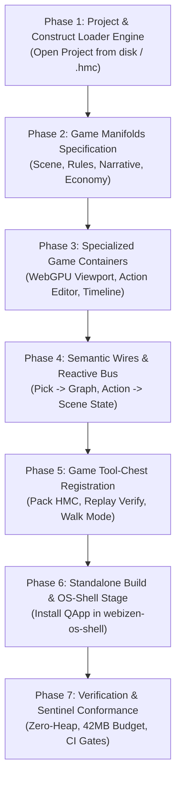

# QualiaDB & Poet — Game Construct & Runtime Integration Plan
_Status: Draft / Approved for Implementation | Date: 2026-10-05_  
_Target Repositories: `C:\github\poet`, `C:\github\game-demo`, `C:\github\webizen-os-shell`_

---

## 1. Executive Summary & Architectural Alignment

### 1.1 The Analogy & Separation of Concerns
* **`qualiaDB` (Core Runtime Engine)**: The underlying foundation — provides zero-copy ABI, 42MB Prolog Sentinel, `QualiaPortal` WebGPU renderer, N3 graph store, SHACL validator, and `VibeScript` VM.
* **`webizen-os-shell` (OS Desktop Shell)**: The sovereign desktop environment — provides the Spatial Halo Bar, StageHost window manager, KeyVault, and Orbit Wheel application launcher.
* **`poet` (Authoring Studio / IDE)**: The creative workbench (analogous to the Unity Editor) — provides multi-lens spatial hypermedia canvases where applications and documents are authored, inspected, sculpted, and tested.
* **`game-demo` (Maslows Challenge / Application Project)**: The independent application project — owns its scene assets (250+ `.10d` meshes), narrative, character rosters, and SHACL action rules. Built *using* Poet, but runs *independently* in `webizen-os-shell` or standalone web browsers.

### 1.2 The Three Granularities in Poet
Poet must support running and authoring applications across three structural tiers:
1. **As a Top-Level Construct (`ConstructSeed`)**: A full game project (e.g. *Maslows Challenge*) opens as an entire observer-scope composition with dedicated lenses (Playable Viewport, SHACL Rules, Narrative, Economy).
2. **As an Embedded Manifold (`ManifoldSeed`)**: A sub-app, mini-game, or simulation lens embedded inside a broader construct (e.g. an interactive water-grid simulation inside a Civics Research construct).
3. **As an Embedded Container (`SeedContainer`)**: A discrete, live playable canvas widget embedded directly alongside documents and spreadsheets on any hypermedia manifold.

---

## 2. Phase Breakdown & Work Orders



---

### Phase 1: Project & Construct Loader Engine

**Objective**: Enable Poet to dynamically load external projects (such as `C:\github\game-demo`) as `ConstructSource::Authored` constructs without hardcoding game code inside the Poet repository.

#### Deliverables:
1. **Project Manifest Ingest (`wasm/src/tool_chest/core/project_loader.rs`)**:
   * Implement `ProjectPackageReader` capable of ingesting:
     * Standalone project directory with `assets/generated/manifest.json`.
     * Sealed Qualia container archive (`.hmc` / `.hcf`) via `qualia_core_db::bundle::BundleReader`.
   * Parse declared entry points, required SHACL shapes, `.10d` scene catalog, and N3 world seeds.
2. **Construct Shelf Integration (`wasm/src/browser/construct_shelf.rs`)**:
   * Add **"Open Project / Ingest Construct"** UI controls:
     * File drag-and-drop target accepting `.hmc` and `.hcf` archives.
     * Local storage / filesystem path picker pointing to project directories.
   * On import, generate a dynamic `ConstructSeed`:
     ```rust
     ConstructSeed {
         id: manifest.id,
         label: manifest.title,
         description: manifest.description,
         icon: "gamepad".into(),
         observer: current_observer_did(),
         honesty: "live".into(),
         default_manifold: manifest.default_manifold.unwrap_or_else(|| "game-scene".into()),
         manifold_ids: manifest.declared_manifolds,
         library_uri: format!("urn:poet:construct:{}", manifest.id),
         required_shapes: manifest.required_shapes,
         source: ConstructSource::Authored,
     }
     ```
   * Register the construct dynamically in `CONSTRUCT_EXTRAS` and activate its default manifold.

---

### Phase 2: Game Manifolds Specification

**Objective**: Define the four canonical game authoring and runtime lenses in `wasm/src/tool_chest/manifolds/`.

#### Deliverables:
1. **`game_scene` Manifold (`wasm/src/tool_chest/manifolds/game_scene.rs`)**:
   * **Default Manifold** for game constructs.
   * **Initial Containers**:
     * `game_viewport`: 1000×600 primary 3D viewport running `QualiaPortal`.
     * `scene_organ_catalog`: 380×300 list of 250+ `.10d` scene meshes and parametric blockouts.
     * `terrain_editor`: 380×280 heightfield curve and ground elevation control.
2. **`game_rules` Manifold (`wasm/src/tool_chest/manifolds/game_rules.rs`)**:
   * **Initial Containers**:
     * `action_catalog_editor`: Visual authoring surface for `ActionDef` (IDs, labels, preconditions).
     * `shacl_gate_inspector`: ShapeSpec validator showing real-time conformance reports ("Why?").
     * `event_tape_timeline`: Scrubbable timeline for `ev:e{seq}` event history and determinism check.
3. **`game_narrative` Manifold (`wasm/src/tool_chest/manifolds/game_narrative.rs`)**:
   * **Initial Containers**:
     * `character_roster`: Protagonist & NPC editor (traits, background, starting positions, personal wallets).
     * `dialogue_and_chapters`: Objective progression tree and scenario endings.
4. **`game_economy` Manifold (`wasm/src/tool_chest/manifolds/game_economy.rs`)**:
   * **Initial Containers**:
     * `treasury_ledger`: Committee-owned funds, labour tokens, and repair contracts.
     * `sdg_indicators`: True-cost tracking and infrastructure impact outcomes.

---

### Phase 3: Specialized Game Containers & Renderers

**Objective**: Implement container renderers in `wasm/src/browser/containers/` and dispatch them in `body.rs`.

#### Deliverables:
1. **Container Dispatcher (`wasm/src/browser/containers/body_game.rs`)**:
   * Wire `body_game::try_fill(document, container, body) -> bool` into `body.rs`.
2. **`game_viewport` Container**:
   * Mounts a WebGPU `<canvas>` initialized with `qualia_core_db::QualiaPortal`.
   * Integrates camera controllers:
     * **Map View**: Isometric top-down overview.
     * **Survey View**: Tilted strategy perspective.
     * **Walk View**: Ground-level exploration with WASD + mouse look.
   * Connects daylight sky presets (1=Midday, 2=Sunset, 3=Night) and style switcher (Storybook vs Earthlight).
   * Ingests authored `Tensor10D` nodes and runs pick polling (`queue_pick` / `poll_pick`).
3. **`action_catalog_editor` Container**:
   * Form and graph view for actions (`rc:action/*`).
   * Allows adding/removing preconditions, `removeN`, `removeAll`, and `add` triples.
   * Real-time SHACL gate preview: displays if the currently loaded world passes or fails each rule.
4. **`event_tape_timeline` Container**:
   * Visual event scrubber displaying sequential event tokens (`ev:e1`, `ev:e2`, ...).
   * Uses `session_replay` to step back in time, allowing the author to inspect world state at any past tick.
   * Branching control: author a new action at tick $k$ to test alternate outcomes without corrupting the baseline tape.
5. **`game_vibe_console` Container**:
   * Interactive VibeScript scratchpad evaluating against `GameSession` world projection (`world.coins`, `world.workshop_online`, etc.).
   * Tests `vibe_query` expressions and simulates `vibe_propose` actions live.

---

### Phase 4: Semantic Wires & Reactive Inter-Container Bus

**Objective**: Link containers on the manifold canvas using Poet’s `SeedConnection` semantic wires so actions in one container reactively update others.

#### Deliverables:
1. **Viewport $\leftrightarrow$ State Wire (`wire:pick_entity`)**:
   * Wire from `game_viewport` to `graph` or `state_inspector`.
   * Clicking a 3D building/character in the WebGPU canvas fires an event selecting its URI (e.g. `rc:workshop`) in the semantic graph.
2. **Action $\leftrightarrow$ Scene State Wire (`wire:trigger_state`)**:
   * Wire from `action_catalog_editor` to `game_viewport`.
   * Simulating or committing an action re-evaluates SHACL gates, mutates the local N3 graph, and swaps the visible `.10d` scene variants (e.g. unpowered workshop -> powered workshop).
3. **Timeline $\leftrightarrow$ World Sync Wire (`wire:time_sync`)**:
   * Wire from `event_tape_timeline` to `game_viewport` and `knowledge`.
   * Scrubbing the timeline rewinds both the N3 state and the 3D scene geometry to that exact historical tick.

---

### Phase 5: Game Tool-Chest & Toolbox Registration

**Objective**: Register dedicated game authoring tools in Poet’s Tool Chest (`wasm/src/browser/registration/`).

#### Deliverables:
1. **Game Toolbox (`wasm/src/browser/registration/register_game_toolbox.rs`)**:
   * Register `Toolbox` with metadata `id: "game_toolbox"`, `label: "Game Studio"`.
   * **Tool Chains**:
     * `Chain: Play & Test`:
       * `Game.launch_walk`: Enter full first-person walking mode in the viewport.
       * `Game.toggle_style`: Switch between Storybook and Earthlight visual presets.
     * `Chain: Determinism & Audit`:
       * `Game.verify_replay`: Replay all accepted actions against the seed; fail on divergence.
       * `Game.validate_shacl`: Batch evaluate all action gates against the current world state.
     * `Chain: Packaging & Export`:
       * `Game.pack_hmc`: Package active `.10d` scene meshes, world triples, and action catalog into a sealed `.hmc` container.
       * `Game.export_standalone`: Export self-contained HTML/WASM distribution bundle.

---

### Phase 6: Standalone Build, Packaging & OS-Shell Integration

**Objective**: Ensure applications created or edited in Poet can be deployed and run directly inside `webizen-os-shell`.

#### Deliverables:
1. **Standardized `.hmc` Packaging Spec**:
   * Ensure `export_construct_hmc` outputs bundles compatible with `BundleReader`:
     * `manifest.json`: Metadata, title, entry manifold, required shapes.
     * `10d/*.10d`: CRC-verified `.10d` scene containers.
     * `world.n3`: Base world state.
     * `actions.json`: SHACL-gated action definitions.
2. **`webizen-os-shell` Dynamic Stage Host Support**:
   * Update `webizen-os-shell/src/state/shell_state.rs`:
     * Extend `VolumeStage` to support installed QApps / constructs.
   * Update `webizen-os-shell/src/components/stage_host.rs`:
     * When launching an installed QApp stage, instantiate the package's WebGPU canvas and zero-copy `qualia-core-db` graph session directly within the stage modal.

---

### Phase 7: Verification, Test Vectors & Sentinel Conformance

**Objective**: Guarantee that all new modules adhere to the Immovable Rules of QualiaDB and Poet.

#### Deliverables:
1. **Zero-Heap Hot-Path Verification**:
   * Per-frame viewport updates, hit-testing, and picking must execute without heap allocations (`assert_zero_alloc` test harness).
2. **42MB Prolog Sentinel Conformance**:
   * Loading full scenes (250+ organs) and running replay verification must stay strictly under the 42MB memory ceiling.
3. **Automated Replay Tape Test**:
   * Replaying 50-step action tapes against Kestrel Flats and Saltwind Reach must produce byte-exact matching world documents.
4. **Honesty Badges**:
   * All game container views must maintain truthful honesty indicators: `live` for active WebGPU/graph sessions, `present` for static inspectable drafts, and `held` for unseeded slots. Never label an unseeded container `live`.

---

## 3. File Modification & Creation Ledger

| Path | Action | Description |
| :--- | :--- | :--- |
| `poet/wasm/Cargo.toml` | Modify | Add `qualia-core-db = { path = "../qualiaDB/crates/qualia-core-db", features = ["wasm-full"] }` matching `qualia.ref`. |
| `poet/wasm/src/tool_chest/core/project_loader.rs` | Create | Ingestion of project manifests and `.hmc` archives into `ConstructSeed`. |
| `poet/wasm/src/tool_chest/constructs/mod.rs` | Modify | Register `game_construct()` and support `ConstructSource::Authored`. |
| `poet/wasm/src/tool_chest/manifolds/game_scene.rs` | Create | 3D scene, organ catalog, and terrain heightfield manifold seed. |
| `poet/wasm/src/tool_chest/manifolds/game_rules.rs` | Create | Action catalogue, SHACL gate, and replay timeline manifold seed. |
| `poet/wasm/src/tool_chest/manifolds/game_narrative.rs` | Create | Character roster, dialogue tree, and chapter progression manifold seed. |
| `poet/wasm/src/tool_chest/manifolds/game_economy.rs` | Create | Treasury, labour token, and SDG indicators manifold seed. |
| `poet/wasm/src/tool_chest/manifolds/mod.rs` | Modify | Re-export and register all game manifold seeds in `all_seeds()`. |
| `poet/wasm/src/browser/containers/body_game.rs` | Create | Dispatch and DOM rendering for all game container views. |
| `poet/wasm/src/browser/containers/body.rs` | Modify | Dispatch `body_game::try_fill` before falling back to placeholder. |
| `poet/wasm/src/browser/construct_shelf.rs` | Modify | Add "Open Project / Archive" UI controls for loading external game repos. |
| `poet/wasm/src/browser/registration/register_game_toolbox.rs` | Create | Register `GameStudio` toolbox with Walk, Verify, Style, and Export tool-chains. |
| `poet/wasm/src/browser/registration/mod.rs` | Modify | Wire `register_game_toolbox(&mut reg)` into `build_registry()`. |
| `webizen-os-shell/src/state/shell_state.rs` | Modify | Expand `VolumeStage` to support installed dynamic QApp packages. |
| `webizen-os-shell/src/components/stage_host.rs` | Modify | Render installed QApp stages mounting `.hmc` packages. |
