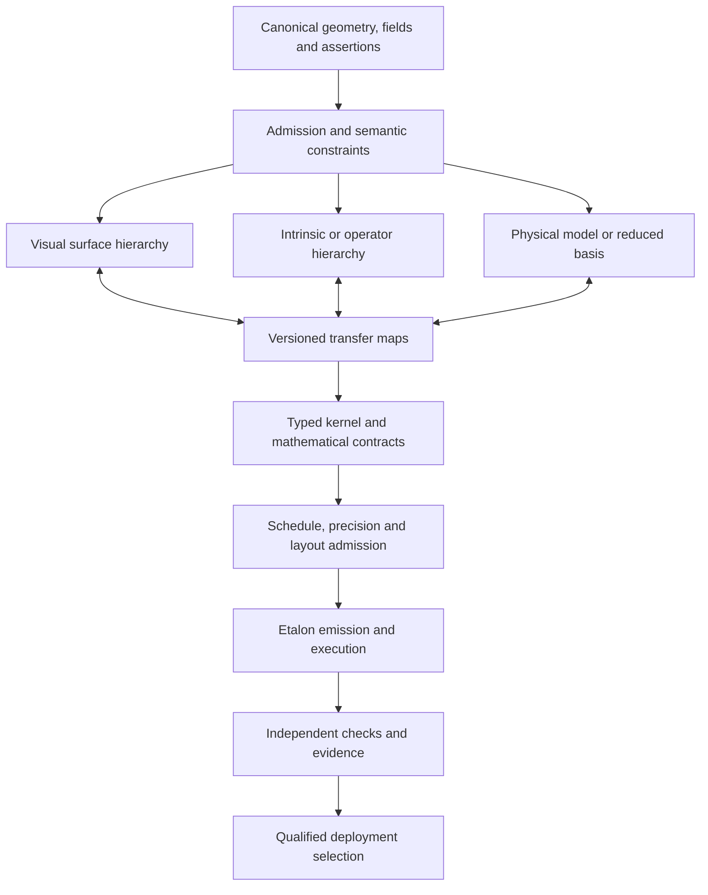

# Intelligent Geometry Optimisation and Verified GPU Programme Generation

## QualiaDB, Etalon, Hypermedia, and Synth — specification competition baseline

**Version:** 0.2 · **Research cut-off:** 16 November 2026 · **Status:** proposed specification, open to competing designs

This document supersedes the earlier architecture draft as the baseline for a specification competition. It defines the problem, reusable foundations, required contracts, research options, and adjudication criteria. It does not report an implemented new pipeline or newly executed qualification tests.

The central proposal is to optimise **a family of related representations and programmes**, rather than one triangle mesh and one shader. Visual geometry, intrinsic surface operators, volumetric physics, material sampling, and GPU schedules have different objectives. They should share identity, constraints, transfer maps, and evidence while remaining independently optimisable.

**Competition objective:** propose the smallest credible architecture that exploits the existing mathematical and production stack to improve resource use at fixed, measurable geometric, semantic, and physical quality. Novelty is welcome when it has a falsifiable benefit. Reuse, numerical correctness, and an executable qualification plan carry more weight than feature count.

### How to read this specification

- **Observed** means a named local implementation was inspected. It does not mean a fresh runtime test passed.
- **Required** means a contract proposed for the competition baseline. It is not a claim about current integration.
- **Candidate** means a research option whose benefit and cost must be established.
- **Research result** means a result reported by the cited authors, within their assumptions and experiments.

`MUST`, `SHOULD`, and `MAY` below express competition requirements. A competing specification may challenge a requirement, but must identify it, explain the conflict, and propose a replacement acceptance test. It must not silently omit it.

The main specification is self-contained. The companion research dossier supplies a study map and exclusions; the source-evidence JSON records local file hashes. Those records identify inspected bytes, not execution evidence.

## 1. Outcomes and scope

### 1.1 Required outcomes

**REQ-01 — Separate objectives.** The design MUST distinguish visual fidelity, intrinsic/operator fidelity, physical response fidelity, semantic preservation, numerical accuracy, and runtime cost. A single weighted score cannot substitute for all acceptance gates.

**REQ-02 — Preserve authority.** Canonical assets, derived representations, execution buffers, and evidence records MUST have separate identities. Replacing a derived mesh must not silently alter empirical source data, assertion status, or solver authority.

**REQ-03 — Reuse before replacement.** Every proposed numerical kernel or geometry algorithm MUST identify the existing library it reuses, extends, or replaces. Replacements require a concrete limitation, an independent comparison, and an ownership decision.

**REQ-04 — Bounded execution.** Construction, compilation, validation, tuning, and runtime execution MUST each have explicit memory, work, and cancellation contracts. Exhaustion produces an identified incomplete/rejected result, never a success-shaped approximation outside its quality contract.

**REQ-05 — Testable claims.** Each claimed improvement MUST state the baseline, workload, input domain, quality budget, and measurement. Source existence, shader validation, and a rendered screenshot establish different things.

### 1.2 Included work and optional tracks

The mandatory core covers triangle-surface optimisation; protected semantic boundaries; transferable attributes; LOD selection; typed numerical lowering to portable WGSL; resource admission; and evidence-based validation. All designs must explain how surface operators and volumetric models connect to that core.

Optional research tracks include intrinsic coarsening, spectral preservation, physical model reduction, appearance optimisation, quad-preserving authoring, learned search, native backend specialisation, and generated adaptive predicates. They are not all prerequisites for a first production release.

A submission MUST separate an implementable first release from later research. It MUST NOT make optional learned inference, new binary formats, or a new compiler mandatory merely to simplify a mesh.

## 2. Existing capabilities and ownership

### 2.1 System boundaries

| Owner | Responsibility |
|---|---|
| QualiaDB | Semantic meaning and provenance; geometry, codecs, mathematical libraries, physical data, application policy, and representation relationships. |
| Etalon | GPU provider, typed numerical execution, shader emission, schedules, device admission, and execution evidence. |
| Hypermedia | Production asset operations and their argument/result contracts. |
| Synth | Composition of named productions, deterministic packaging, presentation, and review. |

Retain `.10d` geometry, sibling `.emf` electromagnetic cells, `.m64` matter/spatial data, `.p64` weights, `.q42` graph records, and `.hmc` production bundles under their existing ownership. A representation descriptor may refer to several of these. It MUST NOT redefine their binary meaning by implication.

The current production contract identifies 150 catalog morphisms. Treat that inventory and current source as authoritative over stale MCP descriptions. Library capability, production-host exposure, and end-to-end qualification are separate facts.

### 2.2 Mathematical reuse map

The following are **observed entry points**, not a claim of universal scale, backend coverage, or numerical guarantees. Paths are relative to `C:/github/qualiaDB/crates/qualia-core-db/src`; full links appear in §15.

| Foundation | Observed implementation | Use in competing designs | Qualification boundary |
|---|---|---|---|
| Dense linear algebra | `solvers/linear_algebra/{cholesky,qr,lu,eigen,svd,gemm}.rs` | Local quadrics, constrained solves, metric validation, reduced bases, independent references. | Dense eigensolvers are not automatically appropriate for million-vertex sparse systems. The inspected SVD forms `AᵀA`; assess conditioning and allocation. |
| Differential calculus | `solvers/calculus/differential.rs` | Derivative checks, Jacobians, sensitivity metrics, local Newton steps. | Includes dual-number operations and finite-difference routines. Inspected JVP/VJP functions apply an already materialised Jacobian; they do not establish a general reverse-mode shader compiler. |
| Analysis and manifolds | `solvers/calculus/{analysis,manifold,exterior}.rs` | Local frames, metrics, coordinate transitions, exterior algebra, convergence records. | The inspected `Interval` provides bounds/coverage utilities; rigorous outward-rounded interval arithmetic needs its own evidence. |
| Units | `solvers/units/` | Dimension checks before combining geometry, forces, energy, frequency, and solver tolerances. | Nondimensionalisation and reference scales still need explicit contracts. |
| Symbolic algebra | `specialized_libs/symbolic_algebra.rs`, `symbolic_assumptions.rs` | Cold expression preparation, differentiation, guarded simplification, provenance. | Real-algebra identities and floating-point programme equivalence are different. Keep allocation out of hot paths. |
| Robust geometry | `computational_geometry/{kernel,expansion,exact_kernel}.rs` | Orientation, incidence, collapse admission, degeneracy handling. | Exact predicates do not imply exact coordinates for constructions or certified metric errors. |
| Discrete differential geometry | `computational_geometry/ddg_operators.rs` | Cotangent matrices, mass, curvature, boundary operators, Poisson/heat building blocks. | Check sign, nullspaces, boundary conditions, and algebraic residuals. The inspected Jacobi report measures iterate change. |
| Geodesics | `computational_geometry/heat_geodesics.rs` | Intrinsic importance fields and distance tests. | Inspected route uses explicit heat steps and bounded Jacobi; it is not the factor-once implicit route described by the original heat-method paper. |
| Metric and mesh quality | `computational_geometry/{mesh_quality,anisotropic_remesh}.rs` | SPD metric fields, element-quality tests, feature-preserving adaptation. | Inspected anisotropic remeshing refines/relaxes/projects; do not assume an unrestricted collapse/flip optimiser. |
| Geometry construction | Existing decimation, remeshing, NURBS, UV atlas, reconstruction, BVH and distance libraries | Build and assess alternatives without duplicating core algorithms. | Capability-specific caps and preconditions remain binding. |
| Resource control | `computational_geometry/geometry_workspace.rs`, calculus workspace/capability modules | Caller-owned scratch, deterministic partition/reduction, cancellation, backend declarations. | Audit actual caller adoption; a workspace type alone does not budget an entire pipeline. |

Etalon already exposes `KernelSpec`, schedules, graph IR, source emitters, validation levels, manifests, tuning, culling, and XPBD volume kernels. Its inspected `df64` GEMM uses paired `f32` values with adapter-sensitive arithmetic assumptions. This is a useful existing precision route, not evidence of universal IEEE binary64 support in WGSL.

**REQ-06 — Capability record.** For each reused path, record symbol, source hash, dimensional limits, allocation class, arithmetic model, backend, failure behaviour, and tests actually executed. Consult the function registry and source before proposing an absent-function remedy. Do not reconstruct an existing library from its name or an outdated summary.

## 3. Architecture: a graph of representations

### 3.1 Representation roles

**REQ-07 — Distinct representations.** A visual mesh, intrinsic triangulation, contact surface, and volumetric solver mesh MAY share topology, but MUST NOT be assumed identical. Their descriptors state role, source identity, units, coordinate frame, domain labels, error contract, and transfer dependencies.

This distinction is supported by research that optimises intrinsic triangulations for surface computation and by spectral simplification that preserves operator behaviour. Neither objective is equivalent to matching rendered silhouettes. [Intrinsic Error Metrics, SIGGRAPH 2023](https://www.markjgillespie.com/Research/intrinsic-coarsening/index.html); [Spectral Mesh Simplification, Eurographics 2020](https://perso.telecom-paristech.fr/boubek/papers/SpectralMeshSimplification/).

### 3.2 Transfer-map contract

For a linear transfer of displacements from coarse to fine degrees of freedom,

$$
u_f=P u_c.
$$

The work-consistent force transfer is

$$
f_c=P^T f_f,
\qquad
f_f^T\delta u_f=f_c^T\delta u_c.
$$

Where appropriate, define a Galerkin coarse model:

$$
M_c=P^T M_fP,
\qquad K_c=P^T K_fP,
\qquad R=M_c^{-1}P^TM_f.
$$

Here `P` maps nodal coefficients; this formula is not a universal restriction operator for every field type. Extensive cell quantities need conservative integration; intensive values may use interpolation; labels need compatibility rules; tangent vectors require frame transport. Nonlinear maps use the appropriate Jacobian transpose for forces.

**REQ-08 — Transfer evidence.** Every map MUST declare source/target revision, direction, domain, sparsity, field semantics, construction method, and error. Test constant reproduction where applicable, rigid motion, virtual work, conservation where claimed, and round-trip error. Across mixed semantic domains, prevent unintended support leakage. Composition of maps must account for conditioning and accumulated error.

Existing `.10d` correspondence records provide a concrete surface-to-tetrahedron route: 16-byte bindings with four quantised weights summing to 65,535. Reuse this representation where it fits. Do not silently overload it to represent arbitrary sparse operator transfers.

### 3.3 Independent assurance axes

Use F0–F4 as application-defined visual fidelity labels and A0–A4 as application-defined assurance labels, each backed by explicit numerical criteria. The labels do not select an integrator, hardware class, or proof level automatically.

A low-detail visual mesh may serve a high-assurance solver. A photorealistic mesh may have no validated physics. If requested assurance is unsupported, reject or use a qualified route; reducing visual detail is not permission to weaken physics or provenance constraints.

## 4. Semantics, admissibility, and geometry objectives

### 4.1 Hard constraints precede ranking

**REQ-09 — Compatibility schema.** Define stable per-face/per-corner/per-vertex tags for material, source/provenance, epistemic category, anatomical/mechanical subpart, feature curve, attachment, and protected region as required by the asset. State which tag changes prohibit a collapse and which merely add cost.

`BifurcationContext64` is a 64-byte observer/filter descriptor. `EpistemicKind` is a separate classification; semantic-decimator sensitivity is another attribute. These MUST NOT be conflated. Confidence may influence sampling density under policy; it does not turn a forbidden merge into a legal one.

**REQ-10 — Collapse admission.** Before ranking a collapse, enforce declared domain compatibility, link/manifold rules, orientation, protected features, and transfer validity. Global self-intersection or contact guarantees require additional checks beyond local normal tests. Input topology mode—strict manifold, stratified non-manifold, or explicit repair—must be selected rather than inferred from successful parsing.

Observed semantic QEM has hard cluster-border rejection and finite semantic penalties by default. Submissions MUST preserve the distinction between an infinite rejection policy and a large finite weight.

### 4.2 Normalised geometric objective

For a candidate point `x`, the standard homogeneous quadric objective is

$$
E_g(x)=\bar x^TQ\bar x,
\qquad \bar x=[x,y,z,1]^T.
$$

QEM remains an efficient ranking baseline, but it is not itself a certified maximum surface distance. Attribute-aware QEM also has a long history; the competition must compare against it rather than describing all conventional simplification as semantically blind. [Garland and Heckbert, SIGGRAPH 1997](https://www.cs.cmu.edu/afs/cs.cmu.edu/user/garland/www/quadrics/index.html); [Colour and texture extension, 1998](https://publications.ri.cmu.edu/storage/publications/pub_files/pub2/garland_michael_1998_1/garland_michael_1998_1.pdf).

**REQ-11 — Dimensionless scoring.** Combine only explicitly normalised error terms:

$$
S=\sum_j w_j\phi_j(e_j/\tau_j),\qquad w_j\geq0.
$$

`e_j` is a named error, `τ_j` its declared scale, and `φ_j` a specified penalty. Hard limits remain separate. Angles, UV distances, metres, force residuals, and epistemic labels must not be summed as untyped numbers.

For constrained local quadrics, a candidate may solve a KKT system. With `Q` partitioned into `A,b,c` and linear constraint `Cx=d`,

$$
\begin{bmatrix}A&C^T\\C&0\end{bmatrix}
\begin{bmatrix}x\\\lambda\end{bmatrix}
=\begin{bmatrix}-b\\d\end{bmatrix}.
$$

State the rank/conditioning test and fallback. Cholesky is appropriate for an SPD block, not the generally indefinite complete KKT matrix. Endpoint/midpoint or constrained-feature candidates are acceptable fallbacks when admitted and measured.

### 4.3 Physics-derived importance

**Candidate.** Derive local importance from dimensionless quantities of interest `q`, with sensitivity `J=∂q/∂ξ` in dimensionless local coordinates `ξ`:

$$
G=J^TWJ+\mu I,\qquad W\succeq0,\quad\mu\geq0,
\qquad E_p=\delta\xi^TG\delta\xi.
$$

This yields a PSD sensitivity penalty. It is a local surrogate, so the accepted representation must still pass response tests. Record operating states and differentiate analytically, with existing dual-number tools, or numerically as supported. Check derivatives independently.

For a residual system `r(u,θ)=0` and objective `J(u,θ)`, an adjoint option is

$$
\left(\frac{\partial r}{\partial u}\right)^T\lambda
=\left(\frac{\partial J}{\partial u}\right)^T,
\qquad
\frac{dJ}{d\theta}
=\frac{\partial J}{\partial\theta}
-\lambda^T\frac{\partial r}{\partial\theta}.
$$

A design using this MUST specify differentiability, boundary conditions, solve accuracy, and treatment of discrete topology changes. It must not differentiate through an edge-collapse decision as though it were a smooth map.

### 4.4 Appearance and animated assets

**REQ-12 — Attribute transfer.** Preserve corner discontinuities, chart seams, tangent handedness, skinning influences, and material identity under a defined mapping. Recompute derived normals/tangents when topology changes; do not interpolate integer labels or average UVs across incompatible charts.

Recent textured-mesh work tracks correspondence during simplification independently of the UV layout. This makes correspondence-preserving transfer a useful candidate alongside seam locking and rebaking. It does not by itself preserve application-specific provenance. [Liu, Zhang, and Yuksel, SIGGRAPH Asia 2025, version 2](https://arxiv.org/abs/2409.15458v2).

**Candidate.** Jointly optimise geometry and material parameters against rendered references, while holding geometric and semantic constraints fixed. Evaluate held-out cameras, lights, poses, and material conditions; an image loss can hide incorrect geometry or bake illumination into albedo. [Appearance-Driven Automatic 3D Model Simplification, EGSR 2021](https://research.nvidia.com/labs/rtr/publication/hasselgren2021diffmodeling/).

For animated assets, measure a declared pose/trajectory ensemble and attach the tested range to the result. A rest-pose error does not bound all future deformations. Preserve attachment behaviour and distinguish skinning error from simulation error.

## 5. Error measurement and admissible approximations

### 5.1 Error is a vector of evidence

**REQ-13 — Error ledger.** Every result MUST retain separate geometry, quantisation, transfer, operator, response, and shader-numerical measurements. Each measurement states units, domain, method, and whether it is a sampled estimate, probabilistic statement, enclosing bound, or proof under stated assumptions.

For surfaces `A` and `B`, the symmetric Hausdorff distance is

$$
d_H(A,B)=\max\left\{
\sup_{a\in A}\inf_{b\in B}\|a-b\|,
\sup_{b\in B}\inf_{a\in A}\|b-a\|
\right\}.
$$

Vertex-only samples can miss interior maxima. A distance algorithm measuring separation between objects is not automatically a Hausdorff evaluator.

**REQ-14 — Bounded-error route.** If a submission claims an enclosing geometric bound, it MUST identify the domain coverage, lower/upper-bound construction, arithmetic assumptions, stopping rule, and exhaustion behaviour. For a bracket `[L,U]`, stop when

$$
U-L\leq\max(\epsilon_{abs},\epsilon_{rel}\ell),
$$

where `ℓ` is a fixed, recorded asset scale. To accept an error threshold `τ`, require `U≤τ`; `L>τ` rejects; an unresolved bracket remains inconclusive. A nearly zero asset extent requires an explicit absolute scale/fallback.

Simplification envelopes established bounded geometric approximation as a distinct goal. Cascading upper bounds and recent GPU wavefront work offer contemporary evaluation options. The latter’s reported hardware results are not portable performance guarantees. [Cohen et al., SIGGRAPH 1996](https://www.cs.umd.edu/~varshney/papers/simp_env.pdf); [Sacht and Jacobson, SGP 2024](https://arxiv.org/abs/2406.10357); [Fan et al., SIGGRAPH 2026 author project](https://min-tang.github.io/GCHD/).

### 5.2 Composition and quantisation

For uniform position rounding with spacings `Δx,Δy,Δz`, an individual-vertex bound is

$$
\epsilon_q\leq\tfrac12\sqrt{\Delta_x^2+\Delta_y^2+\Delta_z^2}.
$$

Extending this to a surface assumes fixed connectivity and corresponding barycentric points. Quantisation can also change degeneracy and predicates; revalidate topology and orientation after decoding.

For compatible geometric mappings, errors may combine through a triangle inequality; under an affine transform, scale a positional bound by the transform’s operator norm. Do not add unrelated QEM costs, spectral residuals, and world-space distances. Transfer composition may amplify errors according to operator norms, not simply add them.

**REQ-15 — Reproducibility scope.** Specify separately: source-generation determinism, asset-byte determinism, ordering determinism, and numerical tolerance across backends. Exact-byte claims MUST include toolchain, arithmetic path, and parallel reduction order. A fixed random seed does not make a floating-point parallel reduction canonical.

## 6. Intrinsic and operator-preserving coarsening

### 6.1 Why a second hierarchy is useful

A surface can look unchanged while diffusion, geodesics, eigenmodes, or a constraint solve changes substantially. Conversely, an intrinsic triangulation useful for computation need not be the renderable piecewise-planar surface. A competing design SHOULD assess whether separate hierarchies outperform forcing one mesh to serve both roles.

**REQ-16 — Operator convention.** Specify the sign and units of stiffness `K`, mass `M`, boundary conditions, nullspace, and field basis. For the positive-semidefinite stiffness convention,

$$
K\phi_i=\lambda_iM\phi_i.
$$

A generic graph Laplacian is not interchangeable with a cotangent surface operator. Negative cotangent edge weights and positive-semidefiniteness of the assembled operator are also different properties. Non-manifold inputs require an explicitly supported domain/operator construction. The tufted-cover Laplacian is one research candidate for difficult inputs. [Sharp and Crane, SGP 2020](https://www.cs.cmu.edu/~kmcrane/Projects/NonmanifoldLaplace/index.html).

### 6.2 Required assessments

For designs claiming operator fidelity, evaluate at least:

- Generalised eigenvalue error over a declared band, excluding or separately handling zero modes.
- Eigenspace distance for repeated or clustered eigenvalues; comparing individual eigenvectors is unstable under sign changes and basis rotations.
- Energy distortion on declared test functions:

$$
e_E(q)=\frac{|q^TK_cq-(Pq)^TK_f(Pq)|}
{\max(|(Pq)^TK_f(Pq)|,E_{floor})}.
$$

- An operator-action defect, with consistent mass weighting, such as `A_f P − P A_c` where `A=M⁻¹K`.
- Downstream quantities: geodesic error, diffusion trajectories, boundary flux, or the actual application solve.

If `K_c=PᵀK_fP`, the displayed energy identity is true by construction up to arithmetic. It is then a useful implementation check but insufficient evidence of approximation quality. Test coarse-space projection error and application solutions against the fine reference as well.

**REQ-17 — Solver evidence.** A solver MUST report a true algebraic residual, constraints/gauge treatment, iterations, and termination cause. An iterate-change norm must be labelled separately. For large systems, specify sparse representation, operator application complexity, preconditioning, and memory. Do not scale a dense Jacobi eigensolver to a large mesh merely because it accepts dynamic dimensions.

The heat-method literature motivates reusable linear-system work. Local `heat_geodesics` and DDG paths already provide a starting point, but their inspected explicit diffusion and Jacobi implementation need stability and convergence assessment for the chosen workload. [Crane, Weischedel, and Wardetzky, Geodesics in Heat](https://arxiv.org/abs/1204.6216).

### 6.3 Optional multilevel path

A submission may construct prolongation, restriction, and Galerkin operators for multigrid or use an intrinsic hierarchy with a different transfer construction. State smoothing, coarse solves, stopping criteria, nullspace preservation, and boundary compatibility. Compare total build-plus-solve cost and amortisation across multiple right-hand sides.

For vector/tensor fields, include frame conventions and connection/transport effects. Scalar interpolation formulas cannot be reused blindly for tangent vectors, rotations, electromagnetic quantities, or stress tensors.

## 7. Physical fidelity and reduced models

### 7.1 Physical model contract

**REQ-18 — Physical authority.** Record constitutive model, parameters and units, rest state, boundary/contact conditions, timestep, integrator, solve tolerance, and relevant sources of uncertainty. Visual simplification may change the presentation without changing these; changes to the physical discretisation require separate evidence.

For a reduced displacement basis `u≈Uq`, standard projections give

$$
M_r=U^TMU,\quad K_r=U^TKU,\quad f_r=U^Tf.
$$

For nonlinear materials, projected matrices alone do not remove the cost of evaluating full-space forces. Hyper-reduction/cubature is an optional acceleration with its own approximation and training-domain contract. [An, Kim, and James, SIGGRAPH Asia 2008](https://graphics.stanford.edu/~djames/publication/optimizing-cubature-for-efficient-integration-of-subspace-deformations/).

Required response metrics depend on the use case: displacement/force curves, compliance, low-frequency modes, resonant frequencies, damping, contact forces, fluxes, and conservation balances. A mesh with smaller geometric error need not have smaller response error.

### 7.2 XPBD and contact

Observed Etalon volume kernels operate on independent tetrahedron records. A connected model requires shared-vertex assembly or a justified scheduling/accumulation strategy. For an XPBD constraint,

$$
\tilde\alpha=\alpha/\Delta t^2,
\qquad
\Delta\lambda=
\frac{-C(x)-\tilde\alpha\lambda}
{\sum_i w_i\|\nabla_iC(x)\|^2+\tilde\alpha}.
$$

Record the definition of `C`; volume and normalised volume constraints require differently scaled compliance. Test substep and iteration choices at comparable cost rather than defining assurance solely by iteration count. [XPBD, MiG 2016](https://matthias-research.github.io/pages/publications/XPBD.pdf); [Small Steps, SCA 2019](https://matthias-research.github.io/pages/publications/smallsteps.pdf).

**REQ-19 — Contact and inversion scope.** Any claim of collision-free or inversion-free evolution MUST identify the collision detection, feasibility, line-search/projection, initial-state, and termination assumptions supporting it. A post-step determinant check or local volume penalty is insufficient to establish such a trajectory guarantee.

IPC is a reference for coupling contact barriers, feasibility, and nonlinear solving. It is an optional comparator/architecture, not a claim that all inspected XPBD paths implement IPC. [Li et al., SIGGRAPH 2020](https://ipc-sim.github.io/).

### 7.3 Field and acoustic correspondence

Electromagnetic data remain in sibling `.emf` cells; their mesh descriptors and RGBA/sonic previews are views of that data. A solver or optimisation pass MUST identify which conserved/intensive quantities it transfers and which derived quantities it recomputes. Energy density, field amplitude, spectral parameters, and displayed colour cannot be substituted for each other merely because they share a sample location.

An acoustic or modal optimisation track SHOULD test the task’s frequency response and mode subspaces. It must distinguish visual geometry reduction from altering the material/discretisation that determines those modes.

## 8. Virtual geometry, streaming, and GPU work generation

### 8.1 Hierarchy validity

**REQ-20 — Coverage and cuts.** The hierarchy MUST define parent-group replacement, shared borders, semantic ownership, and the exact active-cut rule. It must prove or test complete non-overlapping coverage under that rule. Monotonic errors and individually valid meshlets do not establish crack-free coverage alone.

Observed `.10d` `CDAG` uses section type 23 and 64-byte nodes with 64-vertex/124-triangle caps. Existing codecs and their ABI must be reused or explicitly versioned. The inspected Etalon culling kernel takes a separate 12-scalar execution layout and emits a selection mask.

Progressive meshes provide a historical model for refinement and correspondence, while Nanite demonstrates an integrated cluster, streaming, culling, and rendering system. Borrow the relevant contracts; do not infer that a portable WebGPU pipeline inherits Nanite’s complete execution design. [Hoppe, SIGGRAPH 1996](https://hhoppe.com/proj/pm/); [Karis, Stubbe, and Wihlidal, SIGGRAPH 2021 course](https://advances.realtimerendering.com/s2021/).

### 8.2 View and deformation dependence

For the existing sphere-based projection heuristic,

$$
\rho=\frac{\epsilon H}
{2\tan(\theta_y/2)\max(\|c-e\|-r,d_{min})}.
$$

`ε` must be a compatible world-space error. Self and parent use their corresponding bounds. This is a selection heuristic until its relation to projected deviation is qualified for the camera/transform domain.

**REQ-21 — Dynamic bounds.** Test orthographic and perspective paths separately where supported. Define near-plane handling, nonuniform transforms, deformation, multiple views, two-sided materials, camera cuts, and stale occlusion data. Culling may conservatively retain uncertain geometry; it must not discard it on an invalid bound. Normal cones require a deformation/two-sided policy.

### 8.3 Streaming and scheduling

**REQ-22 — Residency.** Keep a resident valid fallback cut. Refine only when all replacement dependencies are ready. Eviction MUST preserve a renderable cut and required semantic coverage. Record page dependencies, bytes, decode/upload cost, and cancellation. Do not use visibility evidence as an access-control decision.

A geometric error bound contributes to priority, not an unconditional instruction to load data. Proposals may use an estimated benefit-per-byte/time priority, but must expose starvation handling, temporal stability, multi-view contention, and behaviour under sustained oversubscription.

**REQ-23 — Work generation.** Specify mask production, stable or unstable compaction, counters, capacities, overflow, indirect records, and render submission. For benchmark comparisons, charge preparation, decoding, upload, compaction, rendering, and readbacks to the appropriate phase. Atomic append order is not deterministic; prefix-scan compaction is an option where order matters.

Portable indexed-indirect records are 20 bytes, with signed `baseVertex`; non-zero `firstInstance` needs the corresponding feature. Feature and resource admission follows the actual device, with a baseline route and explicit native enhancements. [WebGPU specification, 15 September 2026](https://www.w3.org/TR/2026/CRD-webgpu-20260915/).

An optional quad-preserving authoring track may retain edge flow before triangulation for rendering. Recent global discrete optimisation formulates this as an ILP; it belongs in a bounded cold-processing track with solver cost and termination recorded. [Luo et al., SIGGRAPH 2026](https://roy-zzz08.github.io/assets/pdf/Quad.pdf).

## 9. Mathematical contracts and WGSL generation

### 9.1 Proposed lowering layers

**REQ-24 — Semantic IR contract.** Extend existing IR deliberately. The logical layers below are contracts, not a requirement to create five new IR implementations:

| Layer | Required information |
|---|---|
| Mathematical specification | Operation, domain, units, assumptions, boundary conditions, derivatives if claimed, and reference semantics. |
| Discrete operator/kernel | Tensor shapes, indexing, sparse connectivity, state, dependencies, and error model. |
| Schedule | Work partition, tiling, fusion, reduction order, subgroup use, storage/recomputation trade-off. |
| Execution ABI | Binding, element layout, stride, alignment, access, packed-field interpretation, capacity. |
| Evidence | Source/specification identities, admitted features, tests, comparisons, timing, and deployment restrictions. |

Separating algorithms and schedules is supported by Halide’s design. Here the separation must additionally preserve units, topology-dependent indexing, and application error contracts. [Ragan-Kelley et al., SIGGRAPH 2012](https://people.csail.mit.edu/jrk/halide12/).

### 9.2 Symbolic preparation and rewrite legality

Reuse QualiaDB’s expression algebra, assumption-aware simplifier, units, and differential routines for cold preparation and references. Lower only a declared supported subset into Etalon. An unsupported expression returns a typed diagnostic naming the missing lowering or violated domain; it must not fall back to unvalidated generated text.

**REQ-25 — Rewrite record.** Each optimisation rule MUST identify input/output types, assumptions, effect restrictions, and arithmetic semantics. Examples requiring special care include `x/x`, `sqrt(x²)`, reassociation, reciprocal replacement, contraction into FMA, and reduction fusion.

Candidate equality saturation may explore alternative expressions under a bounded node/iteration budget. E-graphs represent the supplied equivalences; they do not make an unsound floating-point rewrite sound. Keep extraction deterministic for fixed cost inputs, and retain the chosen rule/assumption trace. [Willsey et al., POPL 2021](https://arxiv.org/abs/2004.03082).

Separate at least three rewrite classes: exact under a specified discrete semantics; real-algebra equivalence with domain assumptions; and approximate transformation with an error contract. Numeric differential tests are required where appropriate, but do not replace a proof for an “exact” claim.

### 9.3 Effects, bounds, and differentiation

**REQ-26 — Effects and bounds.** A supported graph MUST define read/write regions, aliasing, loop/work bounds, synchronisation, reductions, and resource lifetime. Race freedom cannot be inferred from a well-typed scalar expression. Tail handling must not cause divergent barrier participation. Buffer-length checks must cover all coupled buffers, not just the main input.

**Candidate.** Introduce derivative-producing lowerings for selected smooth kernels, with forward/reverse choices, checkpointing, and gradient accumulation contracts. Slang.D shows the usefulness of first-class differentiable types and compiler transformations; it is an architectural reference rather than an instruction to replace Forge. [Bangaru et al., SIGGRAPH Asia 2023](https://research.nvidia.com/labs/rtr/publication/bangaru2023slangd/).

Derivative tests MUST include analytic cases and numerical checks away from discontinuities. Specify how branches, clamps, contacts, visibility, and topology changes are treated. A gradient for a smoothed surrogate must be labelled as such.

### 9.4 Adaptive geometric predicates

**Candidate.** Generate a fast approximate predicate plus an error filter; uncertain cases go into a bounded worklist for a stronger existing arithmetic route. Exact-predicate decisions must arrive before topology mutation commits. This can reuse QualiaDB’s predicate kernels and Etalon’s execution infrastructure without forcing every operation to maximum precision.

The research basis is adaptive precision and staged predicate generation. Their arithmetic hypotheses must be re-established for a GPU backend; a mathematical derivation for CPU rounding does not automatically transfer to WGSL. [Shewchuk, 1997](https://www.cs.cmu.edu/~quake/robust.html); [Nanevski, Blelloch, and Harper, ICFP 2001](https://www.cs.cmu.edu/~rwh/papers/geompred/icfp01.pdf).

## 10. Precision, portability, and evidence

### 10.1 Numerical admission

**REQ-27 — Arithmetic profile.** Record storage precision, arithmetic/accumulation precision, scaling, range assumptions, exceptional-value handling, cancellation sensitivity, and reduction order. Portable WGSL does not assume native `f64`/`u64`; `f16` is optional. WGSL permits reassociation, so error-free-transform assumptions require explicit backend qualification. [WGSL specification, 6 November 2026](https://www.w3.org/TR/2026/CRD-WGSL-20261106/#floating-point-evaluation).

Use existing `df64` paths where suitable, with their probes and limitations. Paired floats do not have binary64’s exponent range and cannot be advertised as a universal exact-arithmetic substitute. Prefer local coordinate frames and nondimensionalisation when they reduce avoidable conditioning problems.

**REQ-28 — Boundary fixtures.** Qualification MUST include nearly singular systems, tiny/large scales, translated coordinates, nearly coplanar predicates, repeated eigenvalues, under/overflow boundaries, malformed dimensions, and empty/ragged work. Tolerances must distinguish absolute and relative error and define a meaningful near-zero policy.

### 10.2 Three distinct evidence products

| Evidence product | Meaning |
|---|---|
| Algorithmic evidence | Mathematical assumptions, bounds, or invariants of the selected algorithm. |
| Implementation evidence | Source/layout identity, validator results, CPU/GPU comparisons, adversarial fixtures, resource behaviour. |
| Application qualification | Whether the representation and physics meet an intended use under a defined domain and acceptance procedure. |

**REQ-29 — Stage honesty.** Preserve existing Forge levels: Generated → NagaValidated → PipelineCreated → OracleVerified → Profiled → Certified. “Certified” means satisfaction of that scoped Forge procedure. It does not itself establish formal programme correctness, geometric bounds, or application qualification.

Naga checks, pipeline creation, oracle execution, and profiling must be individually recorded. Unsupported adapters and skipped tests remain explicit. Workload-specific expected failures may pass only when the profile declares the rejection outcome in advance.

### 10.3 Record identities and invalidation

**REQ-30 — Dependency-aware evidence.** Bind results to canonical input bytes, semantic policy, transfer/operator version, error-profile version, kernel semantics, source, ABI, schedule, toolchain, feature set, adapter/backend, and test data. A cache key must include every dependency that can invalidate the reused claim.

CRC-32C provides corruption detection. A content hash identifies bytes. Authentication requires a separate signed statement and trust policy if the application needs it. Keep normative identities separate from timestamps and telemetry so reproducible payloads can retain non-reproducible observations without ambiguity.

Change propagation examples:

| Change | Minimum affected evidence |
|---|---|
| Visual QEM weight | Derived geometry, transfer, relevant visual/structural tests. |
| Material/constitutive parameter | Physical response and any sensitivity metric built from that state. |
| Transfer map | Coupling and dependent coarse operators. |
| Workgroup/reduction schedule | Emission/ABI as affected, numerical execution, timing. |
| Driver/backend/compiler | Relevant implementation and performance evidence. |
| Assertion/provenance compatibility policy | Admission and protected-boundary evidence. |

**REQ-31 — Independent testing.** Include differential, property-based, and metamorphic tests with explicit numerical domains. Translate/rotate/scale appropriately; permute identifiers while maintaining semantic identity; compare staged and fused routes; verify `dot(Jv,w)=dot(v,Jᵀw)` for derivative routes. These detect different faults from rendering a plausible image. Semantics-preserving shader transformations also motivate compiler testing, as in GraphicsFuzz; use the methodology without assuming its GLSL tooling is a WGSL validator. [GraphicsFuzz documentation](https://github.com/google/graphicsfuzz/blob/master/docs/glsl-fuzz-intro.md).

## 11. Adaptive optimisation and activation

### 11.1 Constrained search

**REQ-32 — Immutable gates.** Tuning MAY select admissible schedules, layouts, representations, or precision routes. It MUST NOT change protected semantics, evidence requirements, or quality thresholds to make a candidate pass. Training a proposer and validating its outputs are separate activities.

Maintain a Pareto set over build cost, resident bytes, runtime, and accepted errors. If using a scalar objective, publish normalisation and weights. A candidate whose physics fails is not rescued by better frame time.

The baseline MUST include deterministic bounded search or a fixed schedule. A `.p64` learned proposer is optional; compare it against equal-budget non-learned search. Hold out assets, camera paths, and hardware profiles as appropriate. Report the cost of model evaluation and the frequency of invalid proposals.

**REQ-33 — Activation.** Activate only complete qualified dependency sets at a defined job/frame boundary. Retain the previous qualified configuration until the new one is usable. Device loss, budget exhaustion, invalidated evidence, and unavailable residency must have explicit recovery or refusal behaviour.

For irreversible external consumers of simulation state, a mesh/shader rollback alone is insufficient. State migration must define which values are transferred, whether energy or momentum changes, and how that change is measured.

### 11.2 Measured performance

Distinguish cold construction, cold compilation, warm pipeline creation/cache lookup, upload/decode, steady execution, and readback. Where preprocessing is amortised, report

$$
T_{total}(n)=T_{build}+T_{compile}+T_{upload}+nT_{steady}
$$

and the break-even workload against the baseline. A method can win in steady state and lose for a one-shot production.

Performance evidence states timing source, warm-up, sample count, workload, adapter, driver, backend, and resource peaks. Interleave comparable candidates where practical. A p95 from a small sample is a descriptive order statistic, not a precise tail-latency guarantee. If statistical confidence is claimed, define independent experimental units and the interval construction.

## 12. Data and API contracts

The following are **proposed logical records**. Map them to existing types and codecs wherever possible; names below do not assert new production APIs.

| Record | Required fields |
|---|---|
| `AssetContract` | Canonical content identity; representation role; units/frame; topology mode; attributes and semantics; protected entities; source/assertion references; admitted operation set. |
| `QualityProfile` | Named errors and thresholds; measurement classes; reference scale; pose/view/load domains; assurance/fidelity labels; arithmetic and resource limits; expected rejection cases. |
| `RepresentationCandidate` | Parent identity; algorithm and source identity; parameters; remaps/transfers; achieved sizes; unresolved constraints; error ledger; dependency graph. |
| `TransferContract` | Source/target identities; field type; units/frame; interpolation/restriction/force rule; sparsity/capacity; quantisation; validation and domain restrictions. |
| `KernelContract` | Mathematical semantics; discretisation; shapes; effects; assumptions; supported lowerings; precision; resource bounds; reference evaluator. |
| `ExecutionVariant` | Kernel identity; schedule; ABI schema/hash; emitted-source hash; backend features/limits; adapter scope; cache identity. |
| `ValidationReceipt` | Target identities; stage; fixtures/seeds; methods; measured results; pass/fail/inconclusive/skipped status; reason; timing source; resource use; provenance. |

**REQ-34 — Result semantics.** Failure records MUST distinguish invalid input, unsupported capability, unsatisfied constraint, capacity exhaustion, cancelled execution, oracle mismatch, and inconclusive verification. Unmeasured fields remain absent or explicitly `not_measured`, never numeric zero. An optional metric excluded by the profile is `not_applicable` with a reason.

**REQ-35 — Schema evolution.** Reject unknown normative fields or negotiate a declared version. All identifiers need a namespace/version and collision policy. Large sparse maps and evidence arrays belong in referenced typed resources, not an unbounded JSON envelope. Content hashes should be computed over a specified canonical byte representation.

**REQ-36 — Production integration.** Reuse existing morphisms, including `hypermedia.manifold.simplify`, with their real argument contracts. A new library capability does not become a callable morphism automatically. If exposing additional parameters requires catalogue changes, update dispatch, ontology, aliases, and operation inventory together. Do not invent section IDs or reinterpret existing byte records.

## 13. Benchmark and qualification programme

### 13.1 Fixed comparison baselines

Require the relevant subset of these baselines for each claimed improvement:

| Baseline | Purpose |
|---|---|
| B0: identity/no reduction | Reference geometry, semantics, and response. |
| B1: existing geometric QEM | Establish value beyond a cheap current route. |
| B2: existing semantic QEM under the same hard constraints | Isolate benefit beyond semantic penalties and locks. |
| B3: current remeshing/anisotropic route, when appropriate | Compare element-quality and geometry objectives. |
| B4: fixed supported Forge schedule | Measure the value and cost of tuning or generation changes. |
| B5: current fine physical/operator model | Establish response and operator errors. |
| B6: pinned external reference implementation, when feasible | Guard against comparisons only to weak internal settings. |

Meshoptimizer is a useful practical external reference for attribute-aware simplification and clustered LOD. Pin its revision/options and compare equivalent quality/constraint regimes. Its reported library error must not be renamed a certified Hausdorff bound without justification. [Maintainer documentation](https://github.com/zeux/meshoptimizer).

### 13.2 Corpus and adversarial cases

**REQ-37 — Corpus coverage.** The test corpus MUST include the following relevant families, with file hashes, provenance, redistribution rights, and train/tune/test partitions recorded:

| Family | Intended failure exposure |
|---|---|
| Analytic plane, sphere, cylinder, and thin shell | Scale, curvature, known geometry, thin-feature loss. |
| Open boundaries, sharp CAD features, protected pivots | Boundary drift, lock handling, constraint exhaustion. |
| Mixed provenance and epistemic labels | Cross-domain collapse and semantic leakage. |
| UV seams, tiled/checker textures, normal maps | Texture bleeding, tangent errors, correspondence failure. |
| Non-manifold, disconnected, duplicate, degenerate input | Domain-mode admission and repair claims. |
| Geodesic/diffusion/spectral examples | Operator and transfer errors invisible in screenshots. |
| Skinned poses and deforming tetrahedral cases | Rest-only validation, coupling drift, inversion. |
| Contact and high-stiffness scenes | Shared-node races, feasibility, timestep sensitivity. |
| Small features at large world coordinates | Cancellation, quantisation, local-frame assumptions. |
| Camera cuts, near-plane views, missing pages | False culling, cracks, stale occlusion, fallback cuts. |
| Empty, ragged, maximum-size, and exhausted worklists | Bounds, barriers, capacity, cancellation, partial output. |

Public research datasets may complement this corpus but do not supply application semantic labels automatically. Synthetic labelled fixtures are necessary. A screenshot review must include fixed front/side/three-quarter views, held-out views/poses, wireframe, normals, and error overlays as relevant. Numeric checks and visual inspection complement each other.

### 13.3 Proposed starter profiles

These are **competition defaults for well-conditioned synthetic fixtures**, not physical application requirements or measured results. Freeze accepted values before comparing candidates. Competing proposals may replace a default with a reasoned profile revision that applies equally to all submissions.

| Profile | Proposed acceptance values |
|---|---|
| G1 — geometry | Asset extent normalised to diagonal `D=1`; symmetric surface deviation threshold `10⁻³D`; if a bracket is claimed, unresolved bracket width at most `10⁻⁵D`; protected-point displacement at most `10⁻⁵D`; forbidden semantic merges exactly zero. |
| T1 — transfer | Constant/rigid-motion and virtual-work fixtures; tolerance declared from precision and quantisation; no cross-domain support; decoded barycentric sum exactly 65,535 for existing quantised bindings. |
| O1 — surface operator | First 20 nonzero modes where available: proposed 1% relative eigenvalue limit and 5° maximum principal-angle limit for declared clusters; also a downstream diffusion/geodesic test. Define cluster separation and nullspaces before evaluation. |
| P1 — physical response | A declared dimensionless load/trajectory family; proposed 1% RMS and 5% maximum normalised response error with fixed nonzero reference scales; zero accepted inversions where required; contact feasibility assessed separately. |
| K1 — ordinary numerical kernel | For scaled well-conditioned `f32` fixtures, initial `atol=10⁻⁶`, `rtol=10⁻⁵`; exact integer/topology outputs where claimed; ill-conditioned/exceptional cases have separate admitted-domain or rejection tests. |
| R1 — resource/reproducibility | Cold geometry default budget 256 MiB, explicitly revised for larger tracks; no hot-path allocation where the library contract forbids it; three repeated asset/source builds for claimed byte determinism; cancellation and bounded failure fixtures. |

Target face ratios of 75%, 50%, 25%, and 10% can expose different regimes. Failure to reach a ratio while honouring constraints is a valid reported outcome; it is not equivalent to meeting that ratio. Compare accepted error-versus-cost curves and constraint-limited termination rather than only one headline ratio.

For timing, begin with five warm-ups and at least 30 retained measurements, and increase repetitions if noise prevents a useful decision. Qualification of tail behaviour needs more data and a specified method. Freeze a shared search/time budget after measuring the baseline on the adjudication machine; do not assign a universal frame-rate target before hardware and workload are known.

### 13.4 Ablations and acceptance matrix

**REQ-38 — Ablation.** Isolate the effects of attribute penalties, semantic locks, physical sensitivity, correspondence/rebaking, intrinsic transfer, precision, compaction, and scheduling as applicable. Show quality at fixed cost and cost at fixed quality. Report every excluded or failed case in the denominator.

Every normative requirement above maps to an acceptance item: input fixture, expected behaviour, measurement method, threshold, supported backend, retained artifact, and reviewer. Group checks where they test one invariant; avoid hundreds of trivial tests that mirror implementation details.

## 14. Specification competition protocol

### 14.1 What competitors submit

The first round is a **design competition**, not permission to claim unexecuted benchmarks. Submit:

1. A two-page architectural argument and the three most important decisions.
2. A requirement matrix for REQ-01 through REQ-38: accept, refine, challenge, or defer—with reasons and tests.
3. A source-grounded reuse/extension map, including inspected symbols and arithmetic/resource limitations.
4. Mathematical formulations with units, assumptions, bounds, and failure cases.
5. Concrete data/API contracts and a worked asset-to-execution example.
6. A staged implementation plan with dependencies and a smallest useful first release.
7. An executable benchmark/qualification plan, including baselines, adversarial inputs, ablations, budgets, and evidence records.
8. A risk register: likely failure modes, detection, fallback, and the experiments that could disprove the design.
9. A research ledger separating inspected primary sources, inferred design choices, and reproduced results.

### 14.2 Suggested competing approaches

These tracks invite diversity; they do not predetermine a winner:

| Approach | Hypothesis to defend | Main risk to resolve |
|---|---|---|
| A — incremental production | Existing semantic QEM, explicit correspondences, bounded error checks, and stronger Forge contracts provide the best first release. | Local rankings may need expensive post-validation or miss useful operator-aware choices. |
| B — intrinsic/multilevel | Separate surface-operator and visual hierarchies give better end-to-end solve/render cost. | Transfer complexity and preprocessing may outweigh gains for small or changing assets. |
| C — response-driven | Physical/appearance sensitivities and differentiable supported kernels allocate detail more effectively. | Surrogate validity, discontinuities, training/pose coverage, and compilation complexity. |

All tracks must share semantic, resource, and evidence gates. Optional research may improve a proposal but cannot compensate for an incoherent core.

### 14.3 Scoring

| Criterion | Weight | What earns credit |
|---|---:|---|
| Mathematical and numerical correctness | 25 | Explicit assumptions, appropriate solvers, valid error semantics, and failure analysis. |
| Reuse and architectural fit | 20 | Correct ownership, concrete current APIs, minimal duplication, compatibility. |
| Verification and falsifiability | 20 | Independent references, adversarial tests, measurable acceptance, honest evidence. |
| Interfaces and feasibility | 15 | Precise contracts, resource/lifecycle handling, realistic incremental delivery. |
| Performance methodology | 10 | Fair baselines, total cost, break-even analysis, equal-budget tuning. |
| Research value and trade-offs | 10 | Defensible benefit over simpler alternatives and clear experiment priorities. |
| **Total** | **100** | Scores require written evidence and dissent notes. |

Do not award novelty points for renaming existing functionality. Citation count, prose length, and unsupported speedup claims earn no credit. A reasoned rejection of a fashionable technique can score well.

**Admissibility failures:** fabricated execution evidence; silently weakened semantic/quality gates; ignored resource failures; conflated mathematical bounds and samples; destructive replacement of existing ownership/ABIs without a migration case. An incomplete optional prototype is not itself a failure in the design round if labelled accurately.

### 14.4 Rounds and deliverables

- **Round 0 — baseline reconciliation:** freeze source evidence, requirement interpretations, test profiles, and budgets. Identify contradictions without implementing broad rewrites.
- **Round 1 — independent specifications:** compare the required submission packages. Preserve alternative decisions rather than averaging incompatible architectures.
- **Round 2 — adversarial review:** each proposal receives concrete counterexamples and must defend or revise its claims.
- **Round 3 — bounded prototypes:** only after authorisation, implement the smallest experiments that discriminate the strongest competing hypotheses.
- **Round 4 — synthesis:** publish the selected specification, decision records, rejected alternatives, remaining uncertainties, and milestone acceptance matrix.

The handoff agent should organise this process when instructed. Merely receiving this baseline is not an instruction to publish, commit, deploy, or modify production kernels.

### 14.5 Highest-value unresolved questions

1. Which constraints must be hard, and where do finite penalties suffice for real assets?
2. Can existing correspondence paths support an independent operator hierarchy without a new container format?
3. When does geometric bound evaluation dominate simplification, and which incremental checks are valid?
4. What is the smallest useful units/assumptions extension to existing Forge IR?
5. Which derivative and exact-predicate routes justify GPU lowering versus CPU fallback?
6. How much preprocessing is amortised by the expected number of views, poses, or solves?
7. Which errors remain invisible to shared CPU/GPU implementations and require independent or analytic references?
8. Which native features materially improve accepted throughput, while retaining a useful portable route?

## 15. Local evidence map and review limits

Full links below refer to the inspected working tree. The companion `source-evidence-v0.2.json` includes content hashes; recheck live source before implementation. A file listed here is not an assertion that all its functions were reviewed or tested.

| Evidence family | Source |
|---|---|
| Geometric and semantic QEM | [decimate_3.rs](C:/github/qualiaDB/crates/qualia-core-db/src/specialized_libs/computational_geometry/decimate_3.rs), [decimate_3_semantic.rs](C:/github/qualiaDB/crates/qualia-core-db/src/specialized_libs/computational_geometry/decimate_3_semantic.rs) |
| Epistemic context | [bifurcation.rs](C:/github/qualiaDB/crates/qualia-core-db/src/entity_view/bifurcation.rs) |
| Container sections | [section.rs](C:/github/qualiaDB/crates/qualia-core-db/src/container_10d/section.rs), [cluster_dag_section.rs](C:/github/qualiaDB/crates/qualia-core-db/src/container_10d/cluster_dag_section.rs), [correspondence_section.rs](C:/github/qualiaDB/crates/qualia-core-db/src/container_10d/correspondence_section.rs) |
| Decompositions | [linear algebra facade](C:/github/qualiaDB/crates/qualia-core-db/src/solvers/linear_algebra/mod.rs), [eigen.rs](C:/github/qualiaDB/crates/qualia-core-db/src/solvers/linear_algebra/eigen.rs), [svd.rs](C:/github/qualiaDB/crates/qualia-core-db/src/solvers/linear_algebra/svd.rs), [cholesky.rs](C:/github/qualiaDB/crates/qualia-core-db/src/solvers/linear_algebra/cholesky.rs) |
| Calculus | [differential.rs](C:/github/qualiaDB/crates/qualia-core-db/src/solvers/calculus/differential.rs), [analysis.rs](C:/github/qualiaDB/crates/qualia-core-db/src/solvers/calculus/analysis.rs), [manifold.rs](C:/github/qualiaDB/crates/qualia-core-db/src/solvers/calculus/manifold.rs), [exterior.rs](C:/github/qualiaDB/crates/qualia-core-db/src/solvers/calculus/exterior.rs) |
| Units and symbolic preparation | [dimension.rs](C:/github/qualiaDB/crates/qualia-core-db/src/solvers/units/dimension.rs), [symbolic_algebra.rs](C:/github/qualiaDB/crates/qualia-core-db/src/specialized_libs/symbolic_algebra.rs), [symbolic_assumptions.rs](C:/github/qualiaDB/crates/qualia-core-db/src/specialized_libs/symbolic_assumptions.rs) |
| Predicates and DDG | [kernel.rs](C:/github/qualiaDB/crates/qualia-core-db/src/specialized_libs/computational_geometry/kernel.rs), [ddg_operators.rs](C:/github/qualiaDB/crates/qualia-core-db/src/specialized_libs/computational_geometry/ddg_operators.rs), [heat_geodesics.rs](C:/github/qualiaDB/crates/qualia-core-db/src/specialized_libs/computational_geometry/heat_geodesics.rs), [laplacian_3d.rs](C:/github/qualiaDB/crates/qualia-core-db/src/specialized_libs/computational_geometry/laplacian_3d.rs) |
| Mesh metrics and remeshing | [mesh_quality.rs](C:/github/qualiaDB/crates/qualia-core-db/src/specialized_libs/computational_geometry/mesh_quality.rs), [anisotropic_remesh.rs](C:/github/qualiaDB/crates/qualia-core-db/src/specialized_libs/computational_geometry/anisotropic_remesh.rs) |
| Workspace and capability declarations | [geometry_workspace.rs](C:/github/qualiaDB/crates/qualia-core-db/src/specialized_libs/computational_geometry/geometry_workspace.rs), [calculus/workspace.rs](C:/github/qualiaDB/crates/qualia-core-db/src/solvers/calculus/workspace.rs), [calculus/capabilities.rs](C:/github/qualiaDB/crates/qualia-core-db/src/solvers/calculus/capabilities.rs) |
| Etalon public Forge | [lib.rs](C:/github/etalon/crates/etalon-wgsl-forge/src/lib.rs), [ir.rs](C:/github/etalon/crates/etalon-wgsl-forge/src/ir.rs), [graph.rs](C:/github/etalon/crates/etalon-wgsl-forge/src/numerical/ir/graph.rs) |
| Execution kernels | [cull_and_lod.rs](C:/github/etalon/crates/etalon-wgsl-forge/src/numerical/physics/cull_and_lod.rs), [xpbd_volume.rs](C:/github/etalon/crates/etalon-wgsl-forge/src/numerical/physics/xpbd_volume.rs), [df64.rs](C:/github/etalon/crates/etalon-wgsl-forge/src/numerical/emit/df64.rs) |
| Evidence and production | [manifest.rs](C:/github/etalon/crates/etalon-wgsl-forge/src/numerical/manifest.rs), [Forge manual](C:/github/qualiaDB/docs/manuals/wgsl-forge.md), [Hypermedia manifold operations](C:/github/hypermedia-production/crates/asset-production-vibe/src/manifold_ops.rs), [Hypermedia indexed functions](C:/github/hypermedia-production/audit-docs/FUNCTIONS.md) |

### Research and execution limits

The literature review used primary author/project pages, accessible paper text, maintainer documentation, and W3C specifications. Paper titles, versions, and venues were checked where used. The 2026 GPU Hausdorff study was assessed through its author project page; its full PDF exceeded the browsing tool’s size limit. It is included as a promising candidate, not a reproduced or fully audited implementation.

No benchmark, new GPU execution, new shader-validation run, or complete local test suite was executed for this specification. The strongest next step is the competition’s source reconciliation and discriminating experiment design, using the existing stack and the acceptance contracts above.
