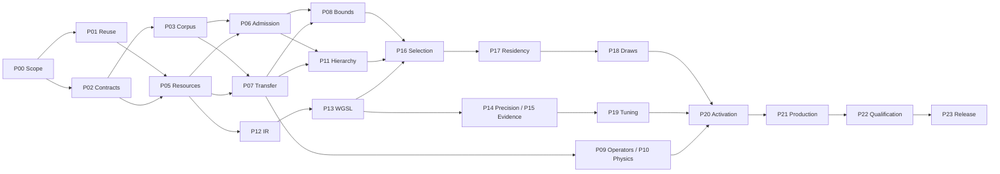

# QualiaDB / Etalon implementation plan and delivery offer

**Version 0.1 · 16 November 2026 · Planning proposal, not an implementation report**

The proposed offer is an **accepted production-core release in 20 working days**, using one coordinator and up to three implementation/review agents. Deliver an end-to-end tracer by day 4 and reforecast after the first two days using actual build, adapter and packet measurements. The current engineering envelope is **12 working days optimistic, 20 targeted, and 35 conservative**. These are judgment-based estimates, not measured throughput or statistical confidence intervals.

The core implements the mandatory scope of [specification v0.2](qualia-etalon-specification-competition-v0.2.md), with every REQ-01–REQ-38 assigned an implementation and acceptance owner. It includes production integration, independent numerical verification, resource failures, visual inspection and reproducible handoff. It is not merely a demo or a collection of unintegrated algorithms.

For **the core plus all eight optional research tracks**, allow approximately **14 working weeks**, with a broad **7–25 week** envelope after freezing a bounded implementation profile for each track. A successful research outcome cannot be guaranteed: a falsified idea is a useful research result but does not count as delivering its promised production capability. The offer therefore stages research through feasibility gates rather than disguising it as certain engineering work.

## 1. What the offer buys

| Delivery tier | Included result | Planning target | Completion test |
|---|---|---:|---|
| Calibration and tracer | Frozen scope, qualified reuse inventory, measured builds and one actual asset-to-GPU/render/evidence path | Days 1–4 | Real outputs and receipts; remaining core gaps listed |
| Production core — recommended commitment | Mandatory triangle-surface, semantic, transfer, LOD, WGSL, resource and evidence pipeline; operator and physical-state interfaces | 20 working days total | All core release gates pass on the frozen support matrix |
| Advanced programme | Core plus R01–R08, each with an accepted bounded application domain | 14 working weeks total, conditional on feasibility | Each claimed advanced capability independently qualifies; failures remain visibly undelivered |

This is a technical delivery proposal. It is not a binding commercial services contract, a guaranteed completion date or authorization to begin implementation. The present task produces the plan and handoff package only. Estimates assume access to the existing repositories, dependencies and reference hardware; decisions and hardware procurement delays are additional elapsed time.

**A working day means eight productive scheduled hours.** The plan does not assume unattended overnight execution, perpetual service availability or that API tokens correspond to human engineering hours. If the swarm is operated for fewer hours per day, elapsed dates move accordingly. Start date is the first authorized implementation session with prerequisites available.

### Frozen core boundary

The baseline release supports a declared, bounded triangle-surface domain, protected material/subpart/provenance boundaries, corner and vertex attributes, visual hierarchies, resident fallback, complete draw generation, portable WGSL generation and qualification. It preserves canonical asset and solver authority. It extends existing codecs, libraries, Forge and morphisms rather than commissioning replacements.

The first accepted profile must include a finite, practically useful mesh envelope within the existing producer limits, a 256 MiB cold geometry budget unless explicitly revised, a documented admitted topology domain, and declared camera/pose/attribute domains. Non-manifold and degenerate cases must either be supported with defined behavior or refused correctly. The scope freeze cannot exclude every difficult fixture simply to report success.

The planned core includes a conservative symmetric deviation bracket for its admitted triangle domain and checks decoded final output. Sampled distance estimates remain useful diagnostics but cannot pass the enclosing-bound profile. Geometry acceptance uses the v0.2 G1 defaults until a justified shared profile change is accepted: upper bound at most `1e-3 D`, bracket width at most `1e-5 D`, protected-point drift at most `1e-5 D`, and zero forbidden semantic merges. Budget-limited inability to prove a bound is `inconclusive`.

Core surface-operator work covers conventions, transfer, real residuals and downstream checks. Core physical work covers authoritative-state interfaces, transfer, scoped response fixtures and refusal of unsupported claims. It does **not** quietly introduce a new general contact solver, a reduced physical model or a scalable spectral coarsener. Those require their research packets. An unsupported guarantee cannot be advertised merely because an existing XPBD kernel executes.

The proposed support matrix is one named native wgpu adapter/backend plus one named browser WebGPU route, with CPU references. P00/P01 must establish the actual device, driver, browser, features and limits. Two routes on the same GPU do not demonstrate cross-vendor portability. A missing required route prevents full acceptance until supplied or the agreed release profile is explicitly changed; a skipped GPU test is not a pass.

## 2. Reuse is the main competitive advantage

The [source evidence](source-evidence-v0.2.json) and specification identify substantial existing mathematical capability. They are an inspected-source baseline, not fresh execution evidence. P01 refreshes hashes and runs targeted probes before treating those paths as qualified. Existing modified files must be preserved; the current Synth checkout is not clean.

| Existing foundation | Planned use | Qualification obligation |
|---|---|---|
| Geometric and semantic QEM | P06 extends admission and ranking | Penalties are not hard locks; QEM cost is not a Hausdorff certificate |
| BVH, distances, robust predicates, workspace control | P05/P08 construct bounded checks | Exact signs do not imply exact constructions; finite intervals do not provide outward rounding automatically |
| UV atlas, tangent/skin and correspondence infrastructure | P07 preserves authored data and transfers | Seams, frames, conserved quantities and tetrahedral versus surface maps remain distinct |
| Dense algebra, calculus, symbolic assumptions, units | Local solves, reference fixtures, dimensions and guarded preparation | Avoid unbounded dense scaling, poorly conditioned normal equations and unsupported floating-point identities |
| DDG and heat/geodesic libraries | P09 defines operator conventions and tests downstream behavior | True algebraic residual differs from iterate change; explicit heat integration has a stability domain |
| `.10d` cluster DAG and correspondence codecs | P11 reuses legal encoding and declared capacities | A stored DAG is not proof of complete coverage; existing tetra records are not arbitrary sparse-map storage |
| Forge IR, emitters, schedules, manifests and numerical kernels | P12–P20 extend existing execution | Mask generation is not a complete draw pipeline; paired f32 is not universal binary64 |
| Existing Hypermedia simplify and Synth produce paths | P04/P21 integrate real outputs | Library presence, catalog exposure and end-to-end qualification are separate |

Before claiming a function is absent or implementing a replacement, read the supplied project contract, search `C:/github/hypermedia-production/audit-docs/FUNCTIONS.md` and the matching module index, then inspect the actual source. The live source catalog is authoritative over stale tool descriptions. Preserve the current 150-operation inventory unless a specifically agreed extension updates ontology, operations, aliases and dispatch together.

QualiaDB owns mathematical meaning, geometry, formats and authority. Etalon owns GPU lowering/provider execution. Hypermedia owns production operations. Synth composes and presents the result. Keep `.10d`, sibling `.emf`, `.m64`, `.p64`, `.q42` and `.hmc` meanings intact; a convenient new record is not permission to repurpose a binary section.

## 3. Swarm operating model

Use **four slots in total**, not four workers plus an invisible supervisor:

| Role | Default model and effort | Responsibility |
|---|---|---|
| Coordinator / integrator | GPT-6.1 Sol, high | Interfaces, dispatch, dependency board, resource leases, cross-repo changes, estimate and final evidence |
| Geometry/numerics worker | GPT-6.1 Sol, high | Admission, transfer, bounds, hierarchy, operator and physical adapters |
| Compiler/runtime worker | GPT-6.1 Sol, high | Existing IR, WGSL, precision, culling, residency and activation |
| QA / bounded implementation worker | GPT-6.1 Terra, medium; Sol for difficult verification | Independent fixtures, manifests, benchmark infrastructure and integration assistance |

These are roles, not permanent worker identities. An Astra reviewer temporarily takes a worker slot. The normal rhythm is two implementation agents plus one independent reviewer, switching to three implementers only while the review queue is clear. No hidden fourth implementation lane is assumed in the estimate.

### Model routing and escalation

Model allocation is a proposed policy to validate in P01/P04, not a claim that a particular model will solve every packet correctly. OpenAI describes Sol/Astra as better choices for the most complex coding and Terra as a lower-cost option; the packet-specific allocation here is our engineering judgment. [Terra model introduction](https://openai.com/index/introducing-gpt-6-1-terra/)

- **Sol/high:** default for production Rust, geometry/ABI contracts, compiler work and difficult integration. It implements the high-risk paths, with independent review.
- **Astra/high:** narrowly scoped mathematical design and adversarial review of P06–P10, P12–P14 and P20/P23. Escalate to xhigh only for an identified unresolved proof or counterexample. Do not ask it to repeatedly reread the entire repository.
- **Terra/medium:** P03 harness plumbing, P15 receipt/cache plumbing and P19 bounded search after contracts are fixed. Sol reviews these packets. Escalate the implementation if it encounters numerical ambiguity.
- **Luna/medium:** optional microtasks for fixture metadata, link/hash inventories, log classification and documentation consistency. It has no independent numerical acceptance authority and is not assigned a high-risk parent packet.

No model can approve its own implementation. Independence primarily means a separate agent, a different derivation/oracle and counterexample-driven review; merely switching model names is insufficient. The strongest available model still needs executable checks.

Dispatch minimal context: exact packet, applicable requirements, interface version, relevant source paths/hashes, accepted dependency receipts and test commands. Prefer a fresh packet context over repeatedly forking the whole research conversation. A larger context is justified only when the dependency graph requires it. Each 8–16 hour packet is executed in bounded 2–4 hour slices with an artifact checkpoint; splitting a packet must preserve its gates and write leases.

After **two failed bounded repair attempts**, stop repeating the same approach. Supply the smallest failing fixture, actual output, hypothesis and attempted fixes to Sol/Astra or the coordinator. An immediate escalation is required for disagreement about a hard invariant, an ABI/format change, invalidated arithmetic assumptions or pressure to loosen a threshold. Do not use token spend as evidence that a result is correct.

### File and resource leases

The coordinator maintains a board with `planned -> ready -> leased -> implementation -> review -> accepted`, plus `blocked` and `rework`. A packet is ready only when dependencies are accepted, interfaces frozen, baseline hashes recorded and exact permitted files assigned.

Only one writer may own a file at a time. The register's write scopes are boundaries to narrow at dispatch, not broad concurrent edit permission. Shared exports, `Cargo.toml`, `Cargo.lock`, catalog/ontology changes, shared schema changes and cross-repository integration belong to the coordinator. A worker needing such a change sends a small proposed patch and rationale. Tests and helper modules can be independently owned; directory separation alone does not prevent shared build or schema conflicts.

Use isolated checkouts/worktrees when practical and authorized, preserving existing uncommitted work. For a shared checkout, leases and accepted baseline hashes are mandatory. Do not reset or overwrite unrelated files. Record the complete cross-repository revision/file-hash set after integration.

Use separate packet build directories and unique output directories. Never rebuild into `C:/github/synth/target` or `target-studio`, or kill the active MCP to clear a lock. Reserve one heavy linker/build resource if RAM measurements require it. Reserve the GPU for one qualification run at a time; performance measurements must not overlap competing GPU work. Create-only Synth outputs need fresh names.

## 4. Packet structure and dependency plan

The full [packet register](swarm-packet-register-v0.1.md) supplies deliverables, checks, permitted scope, model, reviewer, dependencies, risks and three-point effort estimates. The [machine-readable register](swarm-work-packets-v0.1.json) has the same information for a dispatching agent. All execution and evidence fields start as unexecuted.

| Packet | Deliverable | Dependencies | Planning agent-hours |
|---|---|---|---:|
| P00 | Scope, acceptance and workspace freeze | — | 4 |
| P01 | Executed reuse/capability qualification | P00 | 8 |
| P02 | Contracts, identities and failure semantics | P00 | 8 |
| P03 | Independent corpus and oracle harness | P00, P02 | 10 |
| P04 | Early existing-path integration tracer | P01–P03 | 8 |
| P05 | Budgets, scratch and cancellation | P01, P02 | 8 |
| P06 | Hard semantic/topology admission | P01, P03, P05 | 14 |
| P07 | Attribute and correspondence transfers | P02, P03, P05 | 14 |
| P08 | Decoded-output error bounds | P03, P06, P07 | 16 |
| P09 | Operator conventions and true residuals | P01, P03, P07 | 10 |
| P10 | Authoritative physical-state adapters | P03, P07, P09 | 8 |
| P11 | Coherent hierarchy and cut validator | P06, P07 | 12 |
| P12 | Semantic IR and guarded rewrites | P01, P02, P05 | 12 |
| P13 | Bounded WGSL lowering | P03, P12 | 12 |
| P14 | Precision/backend qualification | P13 | 10 |
| P15 | Evidence and dependency-aware cache | P02, P13 | 8 |
| P16 | Conservative view/deformation selection | P08, P11, P13 | 10 |
| P17 | Residency and complete fallback cuts | P16 | 8 |
| P18 | Compaction and complete draw generation | P13, P17 | 8 |
| P19 | Immutable gates and bounded tuning | P08, P14, P15 | 8 |
| P20 | Atomic activation and state migration | P10, P15, P18, P19 | 8 |
| P21 | Production integration and deterministic artifacts | P04, P20 | 8 |
| P22 | Independent ablation/qualification campaign | P09, P10, P14, P21 | 12 |
| P23 | Release acceptance and handoff | P22, all transitive dependencies | 10 |

P02 freezes the collapse-event/remap and transfer-admission contract so P06/P07 can work in parallel. P08 integrates actual collapse admission with actual transfer behavior. P11 can build structural hierarchy tests while P08 finishes error certification; P16 cannot qualify view-dependent selection until both are accepted.

The diagram groups some prerequisites for readability; JSON is the authoritative complete DAG. P04 is an early tracer alongside these paths, not a dependency shortcut that certifies later work.

### The day-four tracer

Use one small mesh with protected subparts and a UV seam. Exercise existing simplification, explicit transfer where available, `.10d` encode/decode, a fixed Forge-generated kernel, actual indexed rendering and an identity-bound receipt. Include empty input, impossible face target and unavailable-device behavior. Capture front, side and three-quarter images and inspect them.

This deliberately measures the existing end-to-end connection first. It does not claim that the later semantic hard locks, conservative bounds, complete streamed hierarchy, activation or full precision matrix already work. Record those gaps. That distinction keeps the early demonstration useful without presenting it as the release.

## 5. Delivery arithmetic and competitive target

The schedule is generated from actual packet dependencies, three execution/review slots, file-group locks and one GPU resource. It is a deterministic list schedule, not a mathematically optimal schedule or a measured predictor. It conservatively reserves the GPU for a whole GPU-labelled packet. Within each packet, implementation and its independent review execute sequentially in the reserved slot; agent identity changes for review.

The model reserves worker capacity even for coordinator-owned delivery packets. The separate coordinator allowance covers continuous dispatch, interface negotiation and integration oversight, not a fourth worker lane. Review consumes **20% of the 234 packet-hours**, approximately 47 hours. That is an allocation to validate, not a reason to cut short a necessary review.

| Estimate component | Optimistic | Planning | Conservative |
|---|---:|---:|---:|
| Packet implementation + independent review | 140.4 h | 234 h | 421.2 h |
| Coordinator/integration overhead | 20 h | 32 h | 48 h |
| Unallocated defect/rework allowance | 15 h | 35 h | 70 h |
| Total cumulative active agent effort | 175.4 h | **301 h** | 539.2 h |
| Dependency/resource schedule before reserve | 9.75 days | 16.25 days | 29.25 days |
| Offered elapsed planning envelope | **12 days** | **20 days** | **35 days** |

The elapsed reserve covers rework and integration delays on critical dependencies. It is not obtained by dividing all hours by three. The 20-day target provides 30 elapsed hours beyond the modelled schedule, so at least five of the 35 rework agent-hours must overlap other work. If all 35 hours land on the critical path, completion moves to approximately day 21 before any additional blocking delay. The conservative figure is an envelope, not a worst-case guarantee. In the planning schedule, the packet work averages roughly 1.8 occupied worker slots because of dependency and GPU constraints. The 301 cumulative hours are neither a labor invoice nor an assertion that 301 human hours would be equivalent.

The serial backbone runs through contract/corpus preparation, admission/transfer, error/hierarchy evidence, conservative selection, residency, complete draw generation, activation and qualification. Compiler and operator work overlap this backbone, but can become critical if numerical or backend assumptions fail.

| Milestone | Target | Required evidence |
|---|---:|---|
| M0 — calibrated baseline | End day 2; complete remaining harness setup early day 3 | Repository state, builds, hardware access, fixed acceptance profile and revised forecast |
| M1 — working tracer | End day 4 | Actual produced asset, compiled/executed kernel, reviewed images and honest receipts |
| M2 — geometry/compiler foundations | Around day 8 | Admission, transfer, bounds, operator interfaces, hierarchy and initial WGSL checks |
| M3 — integrated feature candidate | Days 13–14 | Residency, draws, activation, production path and all required interfaces connected |
| M4 — qualification candidate | Days 16–17 | Corpus, ablations, native/browser results, reproducibility and independent findings |
| M5 — accepted core | **Day 20 target** | Findings resolved, impacted evidence rerun, acceptance matrix and reproducible handoff |

### Reforecast rule

After two days, replace judgment with the first observed build durations, adapter failures, completion/repair times and token receipts. After M1, estimate the remaining longest dependency chain and resource-limited schedule again. Report original target, revised forecast and causal changes side by side. Never improve the forecast by silently removing acceptance checks.

If a packet exceeds its planning allowance by 50%, or a core mathematical premise fails, publish the failing evidence and a bounded remedy before continuing dependent work. Discovery of a pre-existing baseline defect is not automatically charged as new feature work: identify the minimum repair needed for this scope and update the forecast. Optional research cannot consume core release reserve without an explicit scope decision.

## 6. Cost model and where to spend intelligence

The goal is minimum **cost per accepted packet**, including repairs and independent review. A cheap run that creates expensive numerical debugging is not a saving. Conversely, expensive reasoning for formatting fixture metadata does not improve correctness.

The table uses published short-context API rates checked on 16 November 2026. Values are USD per million tokens. The currently exposed collaboration tool lists Priority service; the API pricing page calls Priority **Fast**. Both columns are included so Standard prices are not mistaken for this session's service-tier equivalent. [OpenAI pricing](https://developers.openai.com/api/docs/pricing)

| Model | Standard input / cached input / output | Fast input / cached input / output |
|---|---:|---:|
| GPT-6 Luna | $0.10 / $0.01 / $0.50 | $0.20 / $0.02 / $1.00 |
| GPT-6.1 Terra | $1.00 / $0.05 / $5.00 | $2.00 / $0.10 / $10.00 |
| GPT-6.1 Sol | $2.00 / $0.10 / $10.00 | $4.00 / $0.20 / $20.00 |
| GPT-6 Astra | $10.00 / $1.00 / $50.00 | $20.00 / $2.00 / $100.00 |

Output budgets include reasoning tokens, which are billed as output. Reprice requests crossing model-specific context thresholds rather than applying the short-context table indiscriminately. [Reasoning-token documentation](https://developers.openai.com/api/docs/guides/reasoning), [Sol model pricing rules](https://developers.openai.com/api/docs/models/gpt-6.1-sol)

The [editable cost model](swarm-cost-model-v0.1.json) uses total input tokens across all repeated calls, not unique document size. No caching discount is assumed. Planning allocations are: Luna 4M input / 0.25M output; Terra 10M / 0.75M; Sol 25M / 1.8M; Astra 3M / 0.3M. These are deliberately explicit budget scenarios, **not observed consumption and not a conversion from engineering hours**.

| Core scenario | Standard API equivalent | Fast/Priority API equivalent |
|---|---:|---:|
| Lean | $49.01 | $98.02 |
| Planning | **$127.28** | **$254.55** |
| Rework-heavy | $284.55 | $569.10 |

For planning, hold roughly **$300 of Fast API-equivalent token capacity**, with a separately visible **$600 total contingency envelope**. This is a budget proposal, not an automatic spending authorization or enforceable future cap. Stop and reforecast before exceeding an agreed budget; do not lower quality gates to fit it. These scenarios exclude optional research, tools, GPU/host rental, storage, subscriptions, taxes and any human review. Actual Codex plan consumption or invoices must come from the account's usage records, not this API-equivalent calculation.

For optional tracks, initially budget only the feasibility slice. Measure input/output/rework for that slice, then forecast the production stage. Do not multiply token spend by hours and call it a reliable research price. Keep API receipts per packet/model/service tier and retain cache hits, reasoning output, retries and failed runs in the ledger.

## 7. Optional research programme

Research work starts after core acceptance in this baseline schedule. The coordinator may use a genuinely idle lane earlier only after confirming it cannot delay a core dependency, review or GPU run. Competitive experiments share contracts, corpus and equal work budgets; they do not become duplicate full-stack implementations.

| Track | Bounded proposed result | Planning agent-hours |
|---|---|---:|
| R01 Intrinsic coarsening | Intrinsic hierarchy/transfer with downstream geodesic and diffusion benefit | 70 |
| R02 Spectral preservation | Sparse scalable spectral strategy, clustered eigenspace and downstream tests | 55 |
| R03 Physical reduction | One constitutive/load family, qualified full model, reduction and hyperreduction | 120 |
| R04 Appearance/deformation | Fixed rendering/pose domain, rebaking and temporal quality | 70 |
| R05 Quad authoring | Bounded cold quad optimization and faithful triangulated production | 65 |
| R06 Learned search | `.p64` proposer with measured benefit over equal-budget deterministic search | 50 |
| R07 Native specialization | One explicitly named extra backend or precision route | 75 |
| R08 Adaptive predicates | One generated predicate family with filtered arithmetic and bounded escalation | 85 |
| **Optional packet subtotal** | Includes implementation and independent review | **590** |

Each track splits into approximately 20% feasibility, 60% implementation and 20% independent qualification. Feasibility produces an executable counterexample/benchmark, a source-grounded design and a go/no-go recommendation. Only the accepted production profile proceeds. If an approach fails, either retain the qualified baseline or re-scope and estimate an alternative. A negative experiment does not satisfy the originally promised feature.

For the all-track planning case: core 301 hours + research 590 + research coordination 60 + research uncertainty reserve 90 = approximately **1,041 active agent-hours**. Around 14 working weeks allows for core serial dependencies, limited specialist throughput, staged feasibility decisions and serialized GPU experiments. The broader 7–25 week envelope is engineering judgment; unlike the core schedule, this research calendar is **not a dependency-simulated commitment**. Each track needs a calibrated internal DAG after its feasibility gate.

New general collision/contact solvers, a general reverse-mode compiler, unrestricted e-graph optimization, every native backend, arbitrary geometry domains and novel file formats are excluded unless separately scoped. They are not implied by “all eight tracks.” If the competition winner requires one, the offer must be revised explicitly.

## 8. Excellence means observable release gates

“Excellent” is defined by these checks, not by model choice or the number of generated lines:

1. **Mathematical admission:** hard semantic boundaries, topology/transfer rules, units and reference scales are explicit; invalid input and unsupported guarantees fail with a reason.
2. **Final-artifact fidelity:** geometry/attribute checks run against decoded output; error estimates, conservative bounds and physical response measurements remain distinct.
3. **Independent numerical evidence:** analytic/differential/property/metamorphic checks exercise different failure modes. True residuals, nullspaces, repeated eigenspaces and conditioning are treated correctly for the routes claimed.
4. **Portable execution evidence:** WGSL parsing, pipeline creation, oracle agreement and profiling are separate stages. All required backend entries execute; precision profiles cannot borrow each other's evidence.
5. **Complete runtime behavior:** valid hierarchy cuts, resident fallback, bounded compaction/draws, device loss and atomic activation are tested under adversarial event orderings.
6. **Resource and reproducibility evidence:** instrument allocation/capacity/cancellation; repeat deterministic builds three times where claimed. GPU floating-point repeatability is described within its actual scope.
7. **Fair measured benefit:** compare B0–B5 where relevant and B6 where feasible, with frozen quality and budgets; include preprocessing, compile, upload and steady costs. Failure/exclusion denominators remain visible. No universal frame-rate promise precedes workload/hardware measurement.
8. **Human-reviewable artifacts:** front/side/three-quarter and heldout views, wireframe/normals and error overlays accompany numerical receipts. A successful HTTP response or nonzero triangle count is not a visual review.
9. **Reproducible handoff:** exact source/file hashes, dependency versions, commands, fixtures, accepted configurations, retained receipts, limitations and recovery instructions permit independent rerun.

The [requirement ownership matrix](swarm-requirement-matrix-v0.1.md) must be expanded to name a fixture, expected behavior, method, threshold, backend, artifact and independent reviewer for every applicable requirement. Applicability is a semantic decision grounded in the frozen profile, not an escape hatch for unfinished implementation. The release gate cannot turn an open correctness defect into a documented limitation if it violates the accepted core contract.

## 9. Highest risks and fallback decisions

| Risk | Early falsification / detection | Response |
|---|---|---|
| Conservative error bounds cost too much | P08 near-threshold and large-coordinate fixtures; bound convergence/capacity data | Tighten admitted workload through an explicit profile decision or improve bounded method; keep `inconclusive` honest |
| Transfer/ABI mismatch | P02 contracts, P04 tracer, P07 virtual work and encoded roundtrip | Correct contract once, invalidate dependants and rerun; never reinterpret binary records |
| Existing math has weaker convergence than assumed | P01/P09 true residual and stability probes | Reuse within valid limits or make the minimum justified solver improvement; no silent sparse-to-dense fallback |
| Broken streamed cuts | P11 cut validator, P17 randomized readiness/eviction | Retain resident coarse cut; decline refinement until complete |
| Precision backend discrepancy | P13/P14 adversarial execution and reassociation probes | Disable unqualified route; preserve a qualified baseline or reject unsupported request |
| Shared build/file interference | P00 leases, separate targets, RAM/GPU measurements | Serialize shared writers/builds, preserve unrelated changes, reforecast actual queue cost |
| Correlated agent mistakes | Separate oracle implementation, adversarial reviewer, heldout fixtures | Reopen affected packet and its dependent evidence, not just its prose |
| Research does not outperform existing libraries | Equal-budget feasibility experiment | Keep production baseline and report negative result; stop sunk-cost implementation |

## 10. Handoff package

Give the next orchestrator [the launch brief](swarm-agent-handoff-v0.1.md), this plan, the packet register/JSON, specification v0.2, research dossier and source evidence. The [schedule CSV](swarm-schedule-v0.1.csv) exposes packet timings and resource assumptions; [the generator](build_implementation_plan.py) regenerates the register, schedule and cost scenarios without touching production repositories.

Before implementation begins, reconcile any winning competition proposal with v0.2. Record a requirement delta and recompute affected packets instead of pretending this implementation plan already incorporates an unknown winning design. The first implementation dispatch is P00; optional research is not automatically launched.
